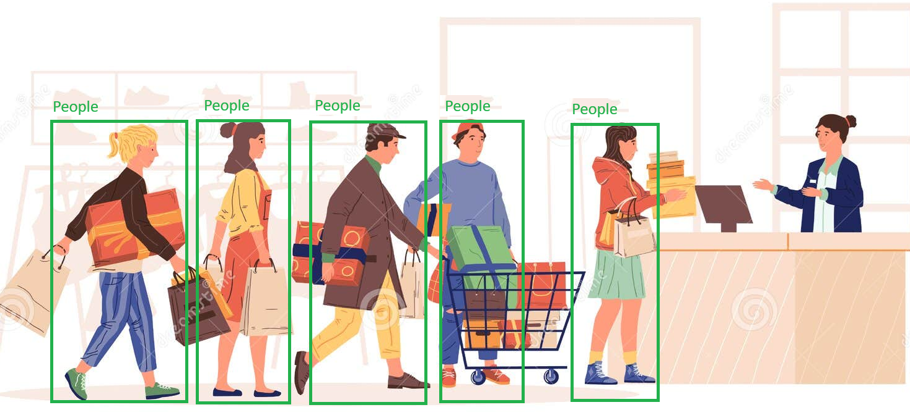
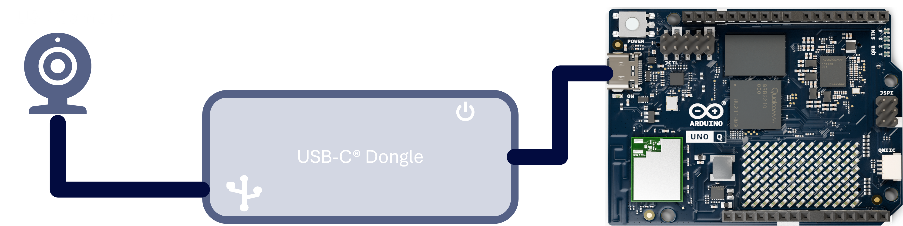
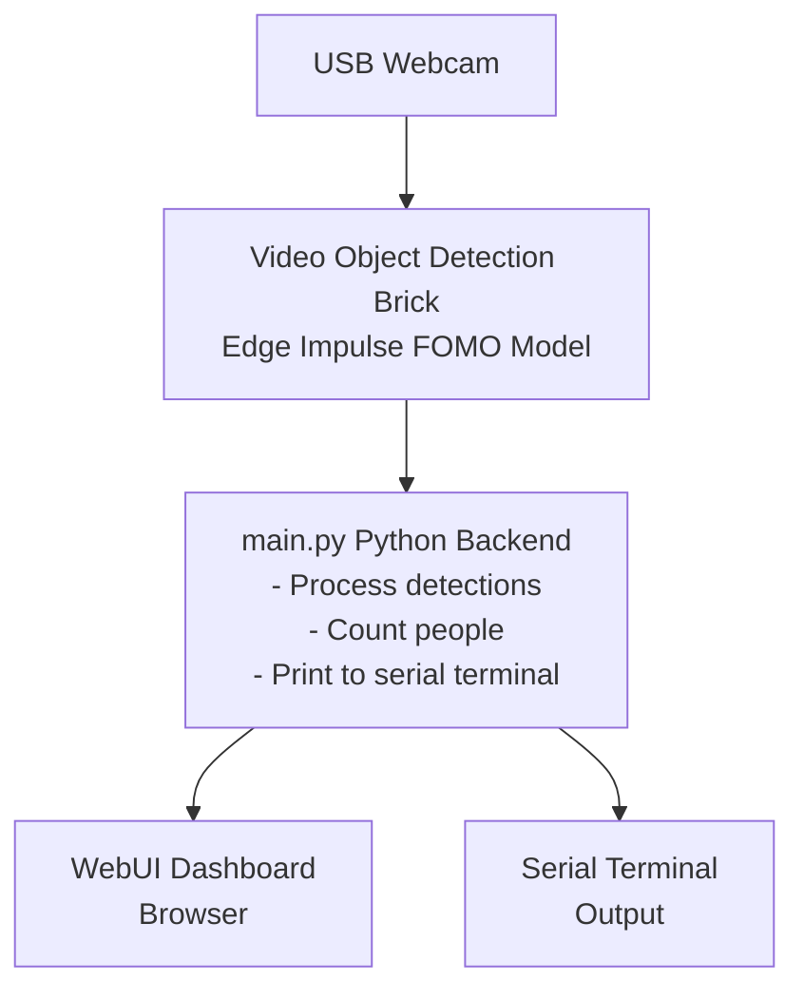
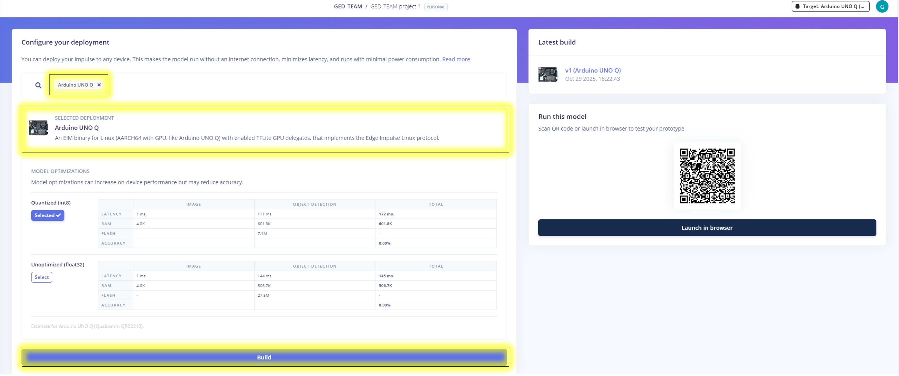
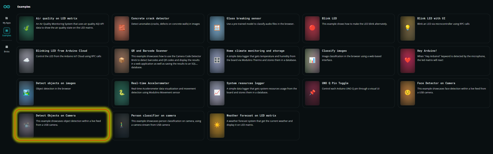
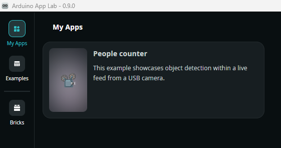
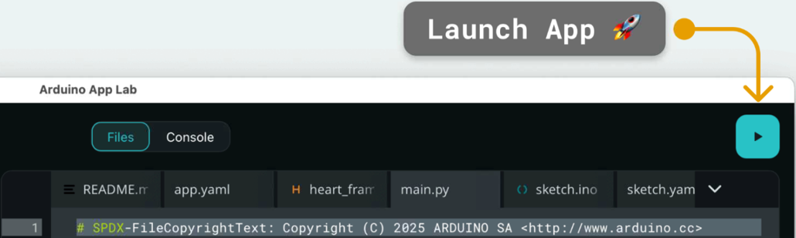
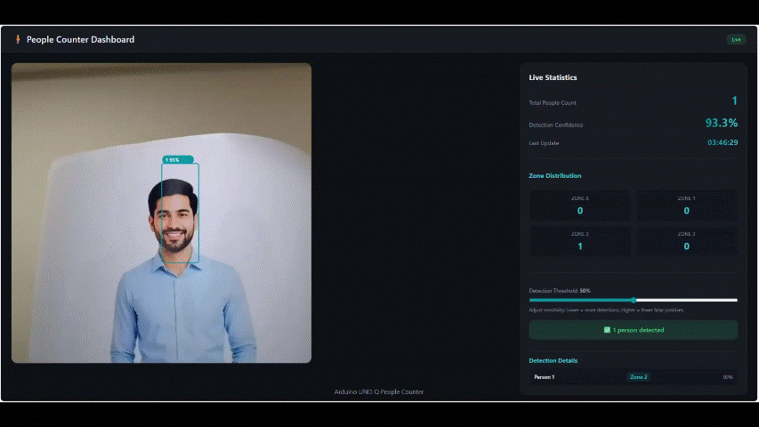
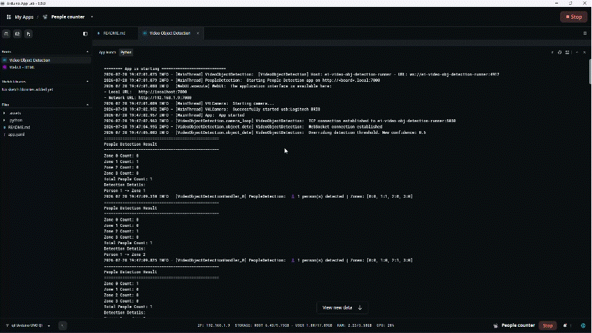
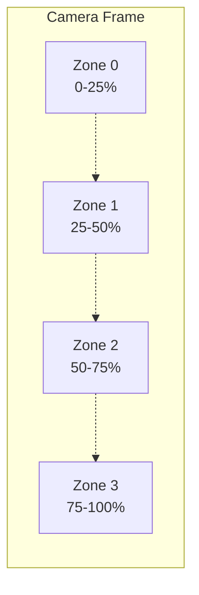

<!-- SPDX-License-Identifier: MIT -->
[Startup_Demo](../../../)/[CV_VR](../../)/[IoT-Robotics](../)/[People Counter using Arduino UNO-Q](./)
# People Counter using Arduino UNO-Q

## Table of Contents
- [1. Overview](#1-overview)
  - [1.1 Key Features](#11-key-features)
  - [1.2 Schematic Diagram](#12-schematic-diagram)
- [2. Requirements](#2-requirements)
  - [2.1 Hardware](#21-hardware)
  - [2.2 Software](#22-software)
- [3. People Counter Workflow](#3-people-counter-workflow)
- [4. Setup Instructions](#4-setup-instructions)
  - [4.1 Setting Up Visual Studio Code (VS Code)](#41-setting-up-visual-studio-code-vs-code)
  - [4.2 Setting Up Arduino App Lab](#42-setting-up-arduino-app-lab)
  - [4.3 Setting Up Arduino Flasher CLI](#43-setting-up-arduino-flasher-cli)
  - [4.4 Setting Up Arduino UNO-Q Device](#44-setting-up-arduino-uno-q-device)
- [5. Dataset Collection and Training](#5-dataset-collection-and-training)
  - [5.1 Download the Dataset](#51-download-the-dataset)
- [6. Get the Model from Edge Impulse](#6-get-the-model-from-edge-impulse)
  - [6.1 Setup an Edge Impulse Account](#61-setup-an-edge-impulse-account)
  - [6.2 Create or Clone the Edge Impulse Project](#62-create-or-clone-the-edge-impulse-project)
  - [6.3 Build and Download Deployable Model](#63-build-and-download-deployable-model)
- [7. Prepare the Application](#7-prepare-the-application)
  - [7.1 Copy Existing Video Detection on Camera Application](#71-copy-existing-video-detection-on-camera-application)
  - [7.2 Upload Model to the Device](#72-upload-model-to-the-device)
  - [7.3 Modify the Configuration File](#73-modify-the-configuration-file)
  - [7.4 Modify the Asset Folder](#74-modify-the-asset-folder)
  - [7.5 Modify the Main Python File](#75-modify-the-main-python-file)
- [8. Run the People Counter Application](#8-run-the-people-counter-application)
  - [8.1 Demo Output](#81-demo-output)
  - [8.2 Zone-Based People Tracking](#82-zone-based-people-tracking)
- [Future Enhancements](#future-enhancements)

## 1. Overview

The **People Counter** application showcases the edge AI capabilities of the **Arduino® UNO Q** using a trained FOMO (Faster Objects, More Objects) model from **Edge Impulse**. This application enables real-time people detection and counting from a live video feed captured by a USB webcam, with visual feedback displayed on the onboard LED matrix.

### 1.1 Key Features

- 📷 **Live People Detection**: Continuously captures frames from a USB camera and detects people using a pre-trained FOMO AI model
- 🧠 **AI-Powered Processing**: Utilizes the `video_objectdetection` Brick to analyze video frames and identify people
- 🔢 **Real-Time Counting**: Accurately counts the number of people detected in each frame
- 🖼️ **Real-Time Visualization**: Displays bounding boxes and people count directly on the video feed
- 🌐 **Web-Based Interface**: Managed through an interactive web interface for seamless control and monitoring
- 📊 **Statistics Tracking**: Maintains running statistics including total count, average, and peak detection
- 🗺️ **Zone-Based People Tracking**: Divides the camera frame into 4 vertical zones to track spatial distribution of detected people in real-time

> ⚠️ **Important:** This demo must be run in **Network Mode or SBC** within the Arduino App Lab.

This demonstration highlights how the Arduino UNO Q can be paired with a USB webcam to perform edge AI tasks such as people detection and counting. It exemplifies the integration of Edge Impulse FOMO models with Arduino hardware for intelligent, real-time computer vision applications.

   

## 1.2 Schematic Diagram



**Components:**
1. **Arduino UNO Q** - Main processing unit with built-in LED matrix
2. **USB Hub** - For connecting multiple USB devices
3. **HDMI Display** - For viewing the video feed and detection results
4. **Keyboard** - For system control
5. **Mouse** - For interface interaction
6. **USB Camera** - For capturing live video feed
7. **Power Supply** - 5V, 3A for USB hub

## 2. Requirements

### 2.1 Hardware

- **[Arduino® UNO Q](../../../Hardware/Arduino_UNO-Q.md#arduino-uno-q)**
- USB camera (x1)
- USB-C® hub adapter with external power (x1)
- A power supply (5 V, 3 A) for the USB hub (e.g., a phone charger)
- HDMI display (x1)
- Keyboard and Mouse (x1 each)
- Personal computer (x86/AMD64) with internet access

### 2.2 Software

- Arduino App Lab.
- Edge Impulse.
- Bricks.
- VS Code.

## 3. People Counter Workflow



## 4. Setup Instructions

Before proceeding further, please ensure that **all the setup steps outlined below are completed in the specified order**. These instructions are essential for configuring the various tools required to successfully run the application.

Each section provides a reference to internal documentation for detailed guidance. Please follow them carefully to avoid any setup issues later in the process.

### 4.1 Setting Up Visual Studio Code (VS Code)

Visual Studio Code is the recommended IDE for editing, debugging, and managing the project's source code. It provides essential extensions and integrations that streamline development workflows.

For detailed steps, refer to the internal documentation:
[Set up VS Code](../../../Tools/Software/VScode_Setup/README.md#34-configure-ssh)

### 4.2 Setting Up Arduino App Lab

Arduino App Lab enables you to create and deploy Apps directly on the Arduino® UNO Q board, which integrates both a microcontroller and a Linux-based microprocessor. The App Lab runs seamlessly on personal computers (Windows, macOS, Linux) and comes pre-installed on the UNO Q, with automatic updates.

For detailed steps, refer to the documentation: 
[Set up Arduino App Lab](../../../Tools/Software/Arduino_App_Lab/README.md#4-installation)

### 4.3 Setting Up Arduino Flasher CLI

Arduino Flasher CLI provides a streamlined way to flash Linux images onto your Arduino UNO Q board. Please follow the setup instructions carefully to avoid flashing errors and ensure proper board initialization.

For detailed steps, refer to the documentation: 
[Arduino Flasher CLI](../../../Hardware/Arduino_UNO-Q.md#flashing-a-new-image-to-the-uno-q)

### 4.4 Setting Up Arduino UNO-Q Device

Arduino UNO-Q must be properly configured to ensure reliable communication with the host system and accurate sensor data acquisition.

For detailed steps, refer to the documentation: 
[Set up Arduino UNO-Q](../../../Hardware/Arduino_UNO-Q.md#uno-q-as-a-single-board-computer)

## 5. Dataset Collection and Training

This section explains how to prepare, convert, and upload a private dataset into Edge Impulse Studio for model training. As an example, we demonstrate this process using the People Counting Dataset from Kaggle.

### 5.1 Download the Dataset

Follow the steps below to download the sample dataset:

1. Visit the Kaggle dataset page: [People Counting Dataset](https://www.kaggle.com/datasets/liorbenassayag/peoplecountingdataset).
2. Download the entire dataset as a ZIP file by clicking the "Download" button at the top right of the page.
3. Extract the ZIP file and organize the files into a folder structure similar to `C:\Dataset\PeopleCounting`.

> ⚠️ **Disclaimer:** The dataset referenced in this project is hosted on Kaggle. Kindly review and comply with the dataset's license terms and conditions as specified on the Kaggle dataset page before accessing, using, or redistributing the data.

## 6. Get the Model from Edge Impulse

Edge Impulse empowers you to build datasets, train machine learning models, and optimize libraries for deployment directly on-device.

Click here to know more about [Edge Impulse](../../../Tools/Software/Edge_Impulse/README.md)

### 6.1 Setup an Edge Impulse Account

An Edge Impulse account is required to access the platform's full suite of tools for building, training, and deploying machine learning models on the Arduino UNO Q.

Follow the instructions to sign up: 
[Signup Instructions](../../../Tools/Software/Edge_Impulse/README.md#22-login-or-signup)

### 6.2 Create or Clone the Edge Impulse Project

You have two options for obtaining a FOMO model for people detection:

#### Option 1: Clone an Existing Project

Clone a pre-trained people detection project using FOMO:

**People Detection Project**: [Edge Impulse Public Project](https://studio.edgeimpulse.com/public/946274/live)

For detailed steps on cloning, refer to the documentation: 
[Clone the Repository](../../../Tools/Software/Edge_Impulse/README.md#29-clone-project-repository)

#### Option 2: Create Your Own FOMO Model

To create your own FOMO model for people detection:

1. **Create a New Project** in Edge Impulse Studio
2. **Collect Data**: 
   - Capture images containing people in various poses and environments
   - Aim for at least 100-200 images for training
   - Include diverse lighting conditions and backgrounds
3. **Label Your Data**:
   - Use the labeling tool to mark people in your images
   - FOMO works with centroid detection, so mark the center of each person
4. **Create Impulse**:
   - Image data: 96x96 pixels (recommended for Arduino UNO Q)
   - Processing block: Image
   - Learning block: Object Detection (FOMO)
5. **Configure FOMO Parameters**:
   - Number of training cycles: 100-200
   - Learning rate: 0.001
   - Validation set: 20%
6. **Train Your Model**:
   - Start training and monitor the accuracy
   - Aim for >85% accuracy for reliable detection
7. **Test Your Model**:
   - Use the Model Testing feature to validate performance
   - Adjust parameters if needed and retrain

### 6.3 Build and Download Deployable Model

Edge Impulse allows you to build optimized machine learning models tailored for deployment on the Arduino UNO Q.

**Mandatory steps:**
1. Navigate to the **Deployment** section in Edge Impulse Studio
2. Select **Arduino UNO Q** as the target hardware
3. Choose **Quantized (int8)** for optimal performance
4. Click **Build** to generate the model
5. The model will automatically download as a `.eim` file



For detailed steps, refer to the documentation: 
[Build and Deploy Model](../../../Tools/Software/Edge_Impulse/README.md#28-download-deployable-model)

## 7. Prepare the Application

This section will guide you on how to create a new application from existing examples, configure Edge Impulse models, set up the application parameters, and build the final App for deployment on the Arduino UNO Q.

### 7.1 Copy Existing Video Detection on Camera Application

Arduino App Lab provides a ready-to-use Video Detection on Camera application that can be copied and customized for your specific use case.

In this example, we are taking the Video Detection on Camera Application and customizing it for people counting.





For detailed steps, refer to the documentation: 
[Copy and Edit Existing Sample](../../../Tools/Software/Arduino_App_Lab/README.md#duplicate-an-existing-example)

### 7.2 Upload Model to the Device

Once the deployable model is built in Edge Impulse, it must be uploaded to the Arduino UNO Q to enable real-time inference and application integration.

Here we will use the model that was downloaded from Edge Impulse in the previous step.
[Build and Deploy Model](#63-build-and-download-deployable-model)

**Upload location**: Make sure to upload the model file to:
```
/home/arduino/.arduino-bricks/ei-models/people_detection_fomo.eim
```

For detailed steps, refer to the documentation: 
[Upload Model](../../../Tools/Software/Arduino_App_Lab/README.md#upload-model-to-device)

### 7.3 Modify the Configuration File

#### Steps

1. **Create your working directory**:
   ```bash
   mkdir my_working_directory
   cd my_working_directory
   ```

2. **Download Your Application**:
   ```bash
   git clone -n --depth=1 --filter=tree:0 https://github.com/qualcomm/Startup-Demos.git
   cd Startup-Demos
   git sparse-checkout set --no-cone /CV_VR/IoT-Robotics/people_counter_arduino_uno_q/
   git checkout
   ```
   
3. **Navigate to Application Directory**:
   ```bash
   cd ./CV_VR/IoT-Robotics/people_counter_arduino_uno_q/
   ```

The `app.yaml` file defines the structure, behavior, and dependencies of your Arduino App Lab application.

```bash
cp app.yaml /home/arduino/ArduinoApps/people-counter/
```

### 7.4 Modify the Asset Folder

The `app.js` and `style.css` files contain the frontend logic that connects to the WebUI Brick's Socket.IO server and updates the dashboard in real-time using detection events from the Python backend.

```bash
cp app.js /home/arduino/ArduinoApps/people-counter/assets
cp style.css /home/arduino/ArduinoApps/people-counter/assets/
```

### 7.5 Modify the Main Python File

The `main.py` file contains the core Python logic for your Arduino App Lab application. It handles communication with connected bricks, runs Edge Impulse model inference, and processes events coming from the App Lab runtime.

```bash
cp main.py /home/arduino/ArduinoApps/people-counter/python/
```

## 8. Run the People Counter Application

Once your application is configured and built in Arduino App Lab, it can be deployed and executed directly on the Arduino UNO Q.



For detailed steps, refer to the documentation: 
[Run Application](../../../Tools/Software/Arduino_App_Lab/README.md#run-example-apps-in-arduino-app-lab)

### 8.1 Demo Output

The application provides multiple forms of output:

1. **Web Interface**: Shows live video feed with bounding boxes around detected people
2. **Console Output**: Provides detailed statistics and detection information





### 8.2 Zone-Based People Tracking

#### Overview

The zone-based tracking system divides the camera frame into 4 vertical zones and tracks the number of people detected in each zone in real-time. This feature provides spatial awareness of people distribution across the camera's field of view.

#### Zone Layout

The camera frame is divided into 4 equal vertical zones from left to right:



Each detected person is assigned to a zone based on their bounding box center position, enabling real-time tracking of people distribution across different areas of the monitored space.

## Future Enhancements

- **Direction Detection**: Track people entering/exiting
- **Data Logging**: Store historical count data
- **Cloud Integration**: Send statistics to cloud dashboard
- **Multi-camera Support**: Aggregate counts from multiple cameras
