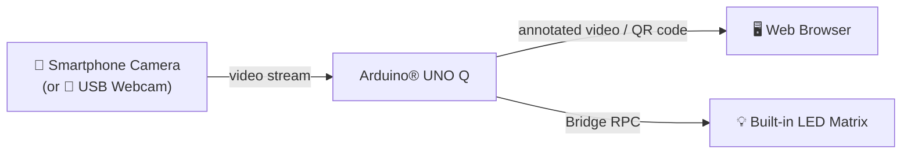
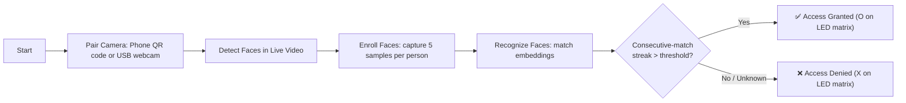
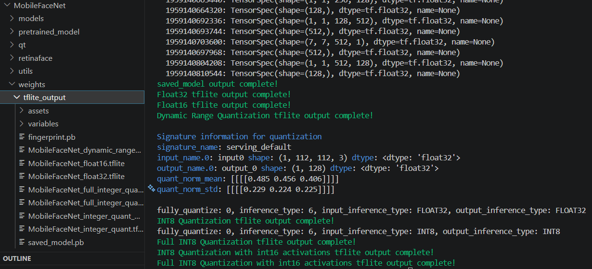
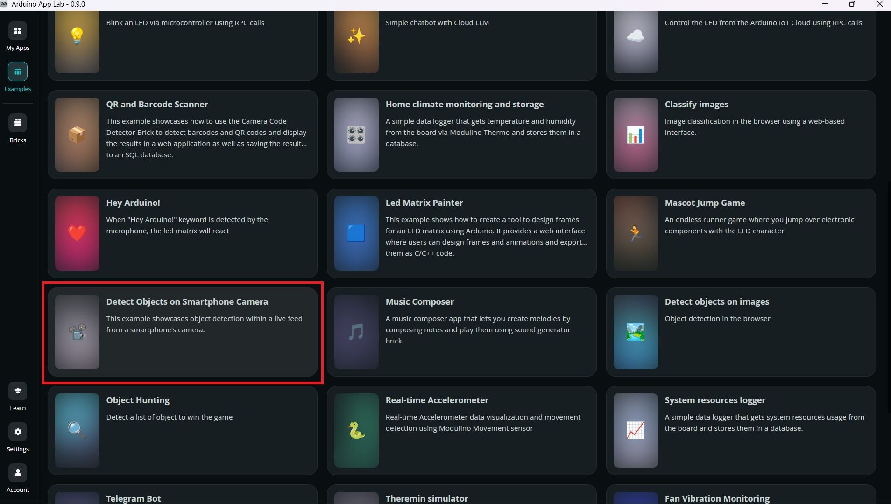
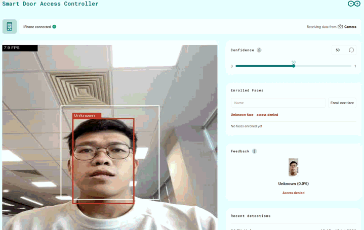
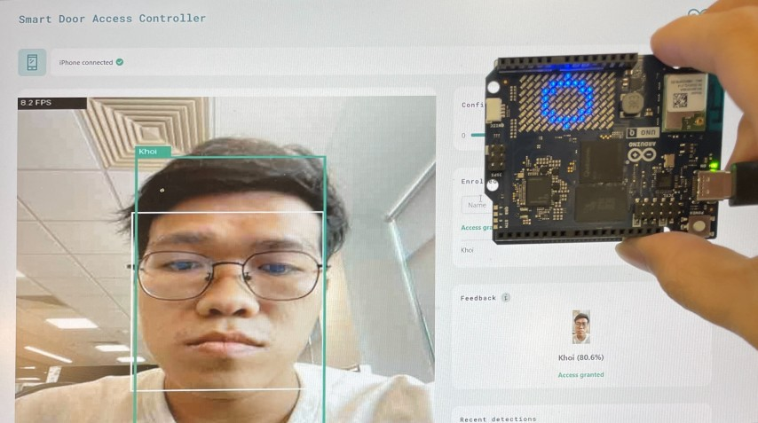

# [Startup_Demo](../../../)/[CV_VR](../../)/[IoT-Robotics](../)/[Smart_Door_Access_Controller](./)

# Smart Door Access Controller

## Table of Contents
- [1. Overview](#1-overview)
- [2. Requirements](#2-requirements)
  - [2.1 Hardware](#21-hardware)
  - [2.2 Software](#22-software)
- [3. Application Workflow](#3-application-workflow)
- [4. Setup Instructions](#4-setup-instructions)
  - [4.1 Setting Up Visual Studio Code (VS Code)](#41-setting-up-visual-studio-code-vs-code)
  - [4.2 Setting Up Arduino App Lab](#42-setting-up-arduino-app-lab)
  - [4.3 Setting Up Arduino Flasher CLI](#43-setting-up-arduino-flasher-cli)
  - [4.4 Setting Up Arduino UNO-Q Device](#44-setting-up-arduino-uno-q-device)
- [5. Face Recognition Model](#5-face-recognition-model)
  - [5.1 Third-Party Model Disclaimer](#51-third-party-model-disclaimer)
  - [5.2 Exploring the Model](#52-exploring-the-model)
  - [5.3 Exporting the Model (PyTorch → ONNX)](#53-exporting-the-model-pytorch--onnx)
  - [5.4 Compiling the Model (ONNX → TensorFlow Lite)](#54-compiling-the-model-onnx--tensorflow-lite)
  - [5.5 Performance Investigation: Model & Quantization Benchmarks](#55-performance-investigation-model--quantization-benchmarks)
- [6. Prepare the Application](#6-prepare-the-application)
  - [6.1 Copy the Detect Objects on Smartphone Camera Example](#61-copy-the-detect-objects-on-smartphone-camera-example)
  - [6.2 Getting the Project](#62-getting-the-project)
  - [6.3 Modify the Configuration File](#63-modify-the-configuration-file)
  - [6.4 Modify the Sketch File](#64-modify-the-sketch-file)
  - [6.5 Modify the Main Python Files](#65-modify-the-main-python-files)
  - [6.6 Using a USB Camera Instead of a Phone](#66-using-a-usb-camera-instead-of-a-phone)
- [7. Run the Smart Door Access Controller Application](#7-run-the-smart-door-access-controller-application)
  - [7.1 Pairing a Camera](#71-pairing-a-camera)
  - [7.2 Enrolling a Face](#72-enrolling-a-face)
  - [7.3 Demo Output](#73-demo-output)

## 1. Overview

The **Smart Door Access Controller** demo showcases the edge AI capabilities of the **Arduino® UNO Q** for real-time face recognition access control. It detects faces on a live camera feed and recognizes enrolled individuals, granting or denying access based on a match against a local database of enrolled faces.

- 📷 **Live Face Detection**: Continuously captures frames from a smartphone or USB camera and detects faces using a pre-trained AI model.
- 🧠 **AI-Powered Recognition**: Uses a **MobileFaceNet** TensorFlow Lite model to compute face embeddings and match them against enrolled identities.
- 🖼️ **Real-Time Visualization**: Displays bounding boxes, recognition state, an FPS counter, and a positioning guide directly on the video feed.
- 💡 **LED Matrix Feedback**: Draws an **O** (access granted) or **X** (denied/unknown) on the board's built-in LED matrix.
- 🌐 **Web-Based Interface**: Managed through an interactive web interface for pairing, enrollment, and monitoring.

This demo highlights how the Arduino UNO Q can pair with a smartphone (or a USB webcam) to perform edge AI face recognition, combining a Linux-side Python pipeline with microcontroller-side LED feedback via the Bridge mechanism.



1. **Arduino® UNO Q**
2. **Smartphone** (via **Arduino IoT Remote** app) — or a **USB camera**
3. **Personal computer** — to view the Web UI in a browser

## 2. Requirements

### 2.1 Hardware

- **[Arduino® UNO Q](../../../Hardware/Arduino_UNO-Q.md#arduino-uno-q-hardware-documentation)**
- **Camera** — either a smartphone (iOS or Android, streamed over the network) **or** a USB webcam plugged directly into the board (x1). See [6.6 Using a USB Camera Instead of a Phone](#66-using-a-usb-camera-instead-of-a-phone).
- Personal computer with internet access (to view the Web UI)

### 2.2 Software

- [Arduino App Lab](../../../Tools/Software/Arduino_App_Lab/README.md)
- [Bricks](../../../Tools/Software/Arduino_App_Lab/README.md#62-bricks)
- [VS Code](../../../Tools/Software/VScode_Setup/README.md)
- **Arduino IoT Remote App** (installed on your smartphone, only needed for the phone-camera option)

## 3. Application Workflow



## 4. Setup Instructions

Before proceeding further, please ensure that **all the setup steps outlined below are completed in the specified order**. These instructions are essential for configuring the various tools required to successfully run the application.

Each section provides a reference to internal documentation for detailed guidance. Please follow them carefully to avoid any setup issues later in the process.

### 4.1 Setting Up Visual Studio Code (VS Code)

Visual Studio Code is the recommended IDE for editing, debugging, and managing the project's source code. It provides essential extensions and integrations that streamline development workflows. Please follow the setup instructions carefully to ensure compatibility with the project environment.

For detailed steps, refer to the internal documentation:
[Set up VS Code](../../../Tools/Software/VScode_Setup/README.md#34-configure-ssh)

### 4.2 Setting Up Arduino App Lab

Arduino App Lab enables you to create and deploy Apps directly on the Arduino® UNO Q board, which integrates both a microcontroller and a Linux-based microprocessor. The App Lab runs seamlessly on personal computers (Windows, macOS, Linux) and comes pre-installed on the UNO Q, with automatic updates. Please follow the setup instructions carefully to ensure smooth development and deployment of Apps.

For detailed steps, refer to the documentation:
[Set up Arduino App Lab](../../../Tools/Software/Arduino_App_Lab/README.md#4-installation)

### 4.3 Setting Up Arduino Flasher CLI

Arduino Flasher CLI provides a streamlined way to flash Linux images onto your Arduino UNO Q board. Please follow the setup instructions carefully to avoid flashing errors and ensure proper board initialization.

For detailed steps, refer to the documentation:
[Arduino Flasher CLI](../../../Hardware/Arduino_UNO-Q.md#flashing-a-new-image-to-the-uno-q)

### 4.4 Setting Up Arduino UNO-Q Device

Arduino UNO-Q must be properly configured to ensure reliable communication with the host system and accurate sensor data acquisition. Please follow the setup instructions carefully to avoid hardware conflicts and ensure seamless integration with the software stack.

For detailed steps, refer to the documentation:
[Set up Arduino UNO-Q](../../../Hardware/Arduino_UNO-Q.md#uno-q-as-a-single-board-computer).

## 5. Face Recognition Model

- Identity matching runs outside the built-in Bricks via a **MobileFaceNet** TensorFlow Lite model (`assets/models/MobileFaceNet_full_integer_quant.tflite`, 112x112x3 input, 128-dim embedding), served by [`ai-edge-litert`](https://pypi.org/project/ai-edge-litert/). Generate the model using the steps in [Section 5.3](#53-exporting-the-model-pytorch--onnx) and [Section 5.4](#54-compiling-the-model-onnx--tensorflow-lite), then copy it to the application directory on the board before running the app.
- Each detected face is cropped, embedded, and matched via cosine similarity against enrolled embeddings (threshold: `0.55`).
- Enrollment captures 5 samples per person; access is granted only after 5+ consecutive matching detections — both tunable in `python/main.py`.
- Preprocessing (ImageNet normalization, quantization handling) and bounding-box margin logic live in `python/face_recognizer.py` / `python/main.py` (`BBOX_MARGIN_RATIO`).

### 5.1 Third-Party Model Disclaimer

> ⚠️ **Disclaimer:** This project uses a **third-party, pre-trained model** — it is not trained, owned, or maintained by Qualcomm.

- **Source:** [foamliu/MobileFaceNet](https://github.com/foamliu/MobileFaceNet) — a PyTorch implementation of *MobileFaceNets: Efficient CNNs for Accurate Real-Time Face Verification on Mobile Devices* ([paper](https://arxiv.org/abs/1804.07573)), trained on a refined subset of the MS-Celeb-1M dataset and evaluated on LFW/MegaFace.
- **License:** [Apache License 2.0](https://github.com/foamliu/MobileFaceNet/blob/master/LICENSE). Review the upstream repository's license and any dataset terms (MS-Celeb-1M, LFW, MegaFace) before redistributing the model or any derivative weights.

### 5.2 Exploring the Model

Before exporting, the upstream repository and its pre-trained checkpoint were inspected to confirm the model was suitable for on-device face recognition:

1. Cloned the repo and reviewed `mobilefacenet.py` (model architecture) and the top-level `README.md` (reported accuracy, training dataset, expected input size).
2. Confirmed the pre-trained checkpoint (`pretrained_model/mobilefacenet_scripted.pt`, and the `weights/mobilefacenet.pt` state dict used for export) expects a `112x112x3` RGB input and outputs a 128-dimension embedding, matching what `python/face_recognizer.py` expects.
3. Loaded the exported ONNX/TFLite graphs in **Netron** to inspect tensor shapes, op types, and (for the quantized variants) the per-tensor `scale`/`zero_point` quantization parameters — this confirmed `FaceRecognizer.embed()` could read those parameters directly from the model rather than hard-coding them.
4. Ran the model's own preprocessing convention (ImageNet mean/std normalization, see [Section 5](#5-face-recognition-model) above) against a few sample crops to sanity-check embeddings before integrating into the full pipeline.

### 5.3 Exporting the Model (PyTorch → ONNX)

**Mandatory step if re-generating the model:**

```bash
git clone https://github.com/foamliu/MobileFaceNet.git
cd MobileFaceNet
pip install onnx2tf onnx_graphsurgeon sng4onnx onnxsim tf_keras
```

Export the pre-trained PyTorch checkpoint to ONNX using the repository's own conversion script (`weights/convert2onnx.py`), which loads `weights/mobilefacenet.pt` and calls `torch.onnx.export()`:

```bash
python weights/convert2onnx.py
```

This produces `weights/MobileFaceNet.onnx`.

### 5.4 Compiling the Model (ONNX → TensorFlow Lite)

Run `onnx2tf` to compile the ONNX graph down to TensorFlow Lite, generating float32, dynamic-range, and full-integer quantized variants in one pass (`-oiqt`):

```bash
python -m onnx2tf -i weights/MobileFaceNet.onnx -o weights/tflite_output -oiqt
```



Copy the resulting model to the board:
```bash
scp -r weights/tflite_output/MobileFaceNet_full_integer_quant.tflite \
  arduino@<board-ip-or-hostname>:/home/arduino/ArduinoApps/smart_door_access_controller/assets/models/MobileFaceNet_full_integer_quant.tflite
```

### 5.5 Performance Investigation: Model & Quantization Benchmarks

The board's Interpreter/inference call (`interpreter.invoke()`) dominates total pipeline latency (>97% of per-detection time), so this is where optimization effort was focused. The `MobileFaceNet_*.tflite` variants (128-dim, from [MobileFaceNet](https://github.com/foamliu/MobileFaceNet) export) were benchmarked on-device (4 threads, XNNPACK CPU delegate), full pipeline including resize/normalize/quantize/invoke/dequantize/L2-normalize:

| Model | I/O dtype | Time/embed | vs float32 |
|---|---|---|---|
| `MobileFaceNet_float32.tflite` | float32 / float32 | 26.2 ms | baseline |
| `MobileFaceNet_dynamic_range_quant.tflite` | float32 / float32 (int8 weights) | 37.9 ms | 44% slower |
| **`MobileFaceNet_full_integer_quant.tflite`** (in use) | **int8 / int8** | **16.1 ms** | **38% faster** |
| `MobileFaceNet_full_integer_quant_with_int16_act.tflite` | int16 / int16 | 716.5 ms | 27x slower |
| `MobileFaceNet_integer_quant.tflite` | float32 / float32 (int8 core) | 15.7 ms | 40% faster |
| `MobileFaceNet_integer_quant_with_int16_act.tflite` | float32 / float32 (int16 core) | 717.1 ms | 27x slower |

All variants produced correct embeddings (L2 norm ≈ 1.0, no NaNs) — differences are purely speed, not correctness.

## 6. Prepare the Application

This section covers getting the project, the Bricks used, the `app.yaml` configuration, and the optional USB camera setup.

The demo uses the following Bricks:

- `web_ui`: Brick to create a web interface to display detection/recognition results, model controls, the pairing QR code, and the face enrollment panel.
- `video_objectdetection`: Brick to detect faces within a live video feed (using the built-in `face-detection` model).
- `dbstorage_sqlstore`: Brick to persist enrolled face embeddings locally on the board.

### 6.1 Copy the Detect Objects on Smartphone Camera Example

This app's Web UI (`assets/index.html`, `app.js`, `style.css`) is built on top of Arduino App Lab's built-in **Detect Objects on Smartphone Camera** example — the phone-pairing QR code, video iframe, and confidence slider all come from that example's frontend. Rather than starting from an empty app, duplicate this example on your Arduino UNO Q device as your starting point:

1. Open Arduino App Lab and go to **Examples**.
2. Locate **Detect Objects on Smartphone Camera** (camera icon).
3. Duplicate it and give the copy a name (e.g. `smart_door_access_controller`).



For detailed steps, refer to the documentation:
[Copy and Edit existing sample](../../../Tools/Software/Arduino_App_Lab/README.md#duplicate-an-existing-example)

This creates the base app (including the `assets/` frontend) on the device. The steps below overwrite/add the face-recognition-specific files (`app.yaml`, `sketch/`, `python/`, and the exported model) on top of it.

### 6.2 Getting the Project

This project lives in the `Startup-Demos` repository. Clone it with a sparse checkout to pull down only this project's folder:

```bash
mkdir my_working_directory
cd my_working_directory

git clone -n --depth=1 --filter=tree:0 https://github.com/qualcomm/Startup-Demos.git
cd Startup-Demos
git sparse-checkout set --no-cone /CV_VR/IoT-Robotics/smart_door_access_controller/
git checkout
```

Navigate to the application directory:

```bash
cd ./CV_VR/IoT-Robotics/smart_door_access_controller/
```

### 6.3 Modify the Configuration File

The `app.yaml` file defines the structure, behavior, and dependencies of the application. Copy it over the duplicated example's `app.yaml`:

```yaml
name: Smart-Door-Access-Controller
description: This example showcases object detection within a live feed from a smartphone's camera.
app_lab_version: 0.9.0
ports:
- 8080
bricks:
- arduino:video_object_detection:
    model: face-detection
    devices:
    - remote_camera_0
- arduino:dbstorage_sqlstore: {}
- arduino:web_ui: {}
icon: 📽️
```

```bash
cp app.yaml /home/arduino/ArduinoApps/smart_door_access_controller/
```

### 6.4 Modify the Sketch File

The `sketch.ino` file contains the main program logic for your Arduino App Lab project. It initializes the LED matrix, exposes the `draw` Bridge provider, and renders whichever pattern the Python app sends (e.g. **O** for access granted, **X** for denied). Copy it over the duplicated example's sketch:

```bash
cp -r sketch/* /home/arduino/ArduinoApps/smart_door_access_controller/sketch/
```

### 6.5 Modify the Main Python Files

The `python/main.py` file contains the core Python logic for your Arduino App Lab application. It handles communication with connected bricks, runs face detection/recognition (via `python/face_recognizer.py`), and processes events coming from the App Lab runtime. Use these files to define custom behaviors, manage data flow, and implement high-level control logic for your application. Copy them over the duplicated example's Python files:

```bash
cp -r python/* /home/arduino/ArduinoApps/smart_door_access_controller/python/
```

If you're re-exporting the face-recognition model yourself instead of using the bundled one, see [5.3 Exporting the Model (PyTorch → ONNX)](#53-exporting-the-model-pytorch--onnx) and [5.4 Compiling the Model (ONNX → TensorFlow Lite)](#54-compiling-the-model-onnx--tensorflow-lite) — copy the resulting `.tflite` file into `assets/models/` on the device before starting the app.

### 6.6 Using a USB Camera Instead of a Phone

By default this app pairs a smartphone camera over the network (QR code + `WebSocketCamera`). If you'd rather plug a USB webcam directly into the board, you can switch to it without touching any of the phone-pairing code:

1. Plug a USB webcam into the Arduino UNO Q (use a USB-C® hub with USB-A ports if needed).
2. In `python/main.py`, set `USB_CAMERA_DEVICE` to your camera, e.g.:
   ```python
   USB_CAMERA_DEVICE = "usb:0"          # first USB camera found
   # or a specific device path:
   USB_CAMERA_DEVICE = "/dev/video2"
   ```
3. Restart the app (`arduino-app-cli app restart user:smart_door_access_controller`).

When `USB_CAMERA_DEVICE` is set, the app constructs a `V4LCamera` (via `arduino.app_peripherals.camera.Camera`) instead of `WebSocketCamera`, skips generating a pairing secret, and the Web UI hides the QR code entirely (the `welcome` message omits `secret`/`protocol`/`ip`/`port` and sets `using_usb_camera: true`, which the frontend uses to show a "Waiting for USB camera" state instead). Everything downstream — face detection, recognition, enrollment, the LED matrix — works identically regardless of camera source, since they all consume the same `BaseCamera` interface.

Leave `USB_CAMERA_DEVICE = None` (the default) to keep using phone pairing.

## 7. Run the Smart Door Access Controller Application

### Option A: Arduino App Lab (GUI)

1. Ensure your Arduino UNO Q is powered and connected to the network.
2. Run the App in Arduino App Lab.
3. The App should open automatically in the web browser. You can open it manually via `<board-name>.local:7000`.
4. The Web UI will display a **QR Code**.

For detailed steps, refer to the documentation:
[Run Application](../../../Tools/Software/Arduino_App_Lab/README.md#run-example-apps-in-arduino-app-lab)

### Option B: `arduino-app-cli` (SSH / headless)

If you don't have access to the App Lab desktop GUI (e.g. you're connecting to the board over SSH), you can run the app directly from the command line.

1. SSH into the board:
   ```bash
   ssh arduino@<board-ip-or-hostname>
   ```
2. Confirm the app is present and check its status:
   ```bash
   arduino-app-cli app list
   ```
   Look for `user:smart_door_access_controller` in the output.
3. Start the app:
   ```bash
   arduino-app-cli app start user:smart_door_access_controller -v
   ```
   This provisions the Python environment (first run only) and starts the `main` and object-detection containers.
4. Verify it's running and tail the logs:
   ```bash
   arduino-app-cli app list
   arduino-app-cli app logs user:smart_door_access_controller --follow
   ```
   The logs will print the Web UI URL, e.g. `http://<board-ip>:7000`.
5. To stop or restart the app later:
   ```bash
   arduino-app-cli app stop user:smart_door_access_controller
   arduino-app-cli app restart user:smart_door_access_controller
   ```
6. On your computer, open `http://<board-ip>:7000` in a browser. The Web UI will display a **QR Code**.

### 7.1 Pairing a Camera

**Using a smartphone (Arduino IoT Remote):**

1. Install the **Arduino IoT Remote** app on your smartphone from your app store.
2. Open the Arduino IoT Remote app on your phone and log in with your Arduino account.
3. Go to Devices, tap on the plus icon to set up a new device and select **Stream phone camera to UNO Q**.
4. Scan the QR code shown in the Web UI.
5. Once connected, the video stream from your phone will appear on the Web UI.
6. Point your phone at a face and check the **Feedback** panel for the recognition result.

**Using a USB camera:** see [6.6 Using a USB Camera Instead of a Phone](#66-using-a-usb-camera-instead-of-a-phone) — no QR pairing needed, the video feed appears automatically once the app starts.

### 7.2 Enrolling a Face

1. In the **Enrolled Faces** panel, type a name and click **Enroll next face**.
2. Point the camera at the person's face and hold still — 5 samples are captured one second apart (progress is shown in the panel, e.g. "Capturing "Alice": 3/5").
3. Once all 5 samples are captured, the name appears in the **Enrolled Faces** list. Show the same face again to the camera — after more than 5 consecutive matching detections, the Feedback panel shows **Access granted: `<name>`** (fewer matches show as "Verifying...").
4. Click the **✕** next to a name to remove that enrollment (all of that person's samples are deleted).

An unrecognized face shows **Unknown face - access denied** in the Feedback panel, and the LED matrix draws an **X**. A granted face draws an **O**.

**How it works:** This demo hosts a Web UI that orchestrates a connection between the camera and the board. The video stream is received over the network (or locally, for USB), faces are located using the `video_objectdetection` Brick (`face-detection` model), and each detected face is cropped from the frame and passed to a MobileFaceNet model to compute an identity embedding. Enrollment stores multiple samples per person; recognition requires a consecutive-match streak before granting access. A background thread continuously streams the live camera feed (with a guide box, FPS counter, and the most recent face result overlaid) to the browser, independent of whether a face is currently detected.

### 7.3 Demo Output



Trigger led with led matrix when access granted on Arduino Uno Q

