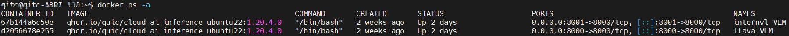
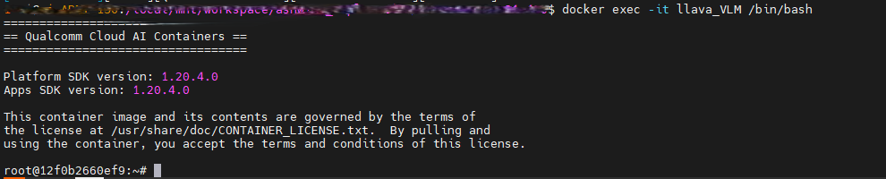
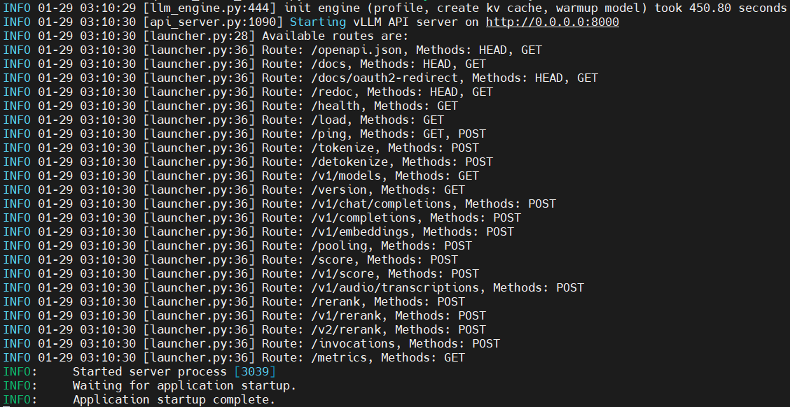
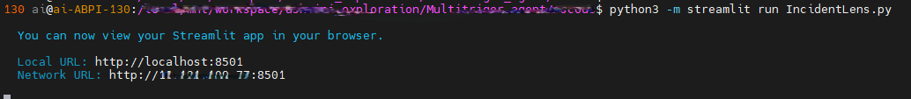
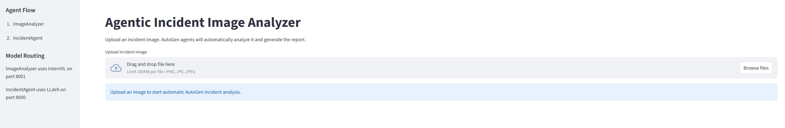

# [Startup_Demo](../../../)/[GenAI](../../)/[CloudAI-Playground](../)/[Agentic_Incident_Image_Analyzer](./)
# Agentic Incident Image Analyzer

## 📘Table of Contents
- [Overview](#1overview)
- [Features](#2features)
- [Cloud AI SDK Setup](#3-cloud-ai-sdk-setup)
- [Launching the Server](#4-launching-the-server)
- [Run Agentic Incident Analyzer Application](#5-run-agentic-incident-analyzer-application)
- [Application Demo](#6-application-demo)

---
## 1.Overview

The Agentic Incident Image Analyzer is an AI-powered solution that automatically analyzes incident images to extract technical insights and generate structured incident reports. It leverages advanced vision-language models and multi-agent orchestration to provide comprehensive incident analysis, root cause identification, and severity assessment in a streamlined, user-friendly interface.

The solution combines:

- 🤖 AutoGen multi-agent workflow orchestration
- 👁️ InternVL vision-language model for image understanding
- 🦙 LLaVA vision-language model for incident reasoning
- 🎨 Streamlit-based user dashboard
- ⚡ Qualcomm Cloud AI 100 (AIC100) acceleration

Users simply upload an incident image through a web interface.

The application automatically:

- 📸 Analyzes the uploaded image
- 🔍 Extracts technical evidence
- ⚠️ Identifies visible issues and affected systems
- 🎯 Determines likely root cause
- 📊 Estimates severity level
- 📋 Creates a structured incident report

---
## 2.Features

- **Agentic Incident Analysis:** Uses AutoGen-based agents to collaboratively analyze incident images, extract technical evidence, and generate incident reports.

- **Image-Based Incident Understanding:** Analyze screenshots, alerts, dashboards, error pages, and system failure images to identify visible issues and affected systems.

- **Root Cause Investigation:** Automatically generates probable root cause, issue category, severity level, business impact, and recommended actions.

- **Unified Streamlit Dashboard:** Single web interface for uploading incident images, monitoring agent execution, reviewing analysis results, and downloading reports.

- **AutoGen Multi-Agent Workflow:** Orchestrates ImageAnalyzer and IncidentAgent through an automated agent communication workflow.

- **Vision-Language Inference (VLM Support):** Supports multimodal image and text reasoning through models such as InternVL2‑5‑1B and LLaVA‑1.5‑7B.

- **Hardware Accelerated AI Inference:** Utilizes Qualcomm Cloud AI 100 accelerators for efficient vision understanding and incident reasoning workloads.

---

## 3. Cloud AI SDK Setup


> ✅ Before you begin following this guide, you need to pre-install the Qualcomm Cloud AI SDK and Docker.

Please refer to the [Cloud_AISDK_Setup](../../../Tools/Software/Cloud_AISDK_Setup/README.md) section below:

- [SDK Installation](../../../Tools/Software/Cloud_AISDK_Setup/README.md#31-sdk-installation-and-setup)
- [Docker Installation](../../../Tools/Software/Cloud_AISDK_Setup/README.md#4-download-the-docker-image)

### 3.1 Create Two Containers for Model Deployment

In this sample, two VLM models are used by the Web Client, so two containers need to be created to establish the servers.


### 3.2 Setting Up the First Container

Since the first model used in this sample is the VLM model **llava-hf/llava-1.5-7b-hf**, and its number of attention heads (16) can be evenly divided by the two QAIC devices, it supports distributed inference across both devices. 

Therefore, when creating the container, we map two QAIC devices to the Docker container and leave the remaining two QAIC devices for the other VLM model.

Use the following command to create the container:
```bash
docker run -dit --name llava_VLM --device=/dev/accel/accel0 --device=/dev/accel/accel1 -v /home/qitc/:/home/qitc/ -p 8000:8000 ghcr.io/quic/cloud_ai_inference_ubuntu22:1.20.4.0
```

💡*Note: Multi‑device execution requires the model’s number of attention heads to be divisible by the number of QAIC devices.*

### 3.3 Setting Up the Second Container

Since the first container uses the two devices accel0 and accel1, we can only use the remaining two devices, accel2 and accel3, for this container.

The second point to notice is the port mapping. Since each container exposes the same internal service port, we need to change the host‑side port when mapping this container so that the Web Client can access it properly.

Use the following command to create the container:
```bash
docker run -dit --name internvl_VLM --device=/dev/accel/accel2 --device=/dev/accel/accel3 -v /home/qitc/:/home/qitc/ -p 8001:8000 ghcr.io/quic/cloud_ai_inference_ubuntu22:1.20.4.0
```

---
## 4. Launching the Server

In this section, we will enter both containers to launch the two servers.

You can use the following command to check the existing containers and their status, and you should see results similar to the image below:
```bash
docker ps -a
```



### 4.1 Setting Up the llava‑hf Model Server

Enter the first container named llava_VLM, which was created earlier.
```bash
docker exec -it llava_VLM /bin/bash
```
If it succeeds, you should see a message similar to the one below.



Open the Python virtual environment that is already included in the image.

```bash
source /opt/vllm-env/bin/activate
```

Below is the command used to start the llava-hf/llava-1.5-7b-hf model server on QAIC devices (accel0 & accel1).

In this sample, I use the OpenAI‑compatible API provided by vLLM to quickly launch a VLM server.
vLLM also supports additional API server modes depending on your deployment needs.

In this command, the options --device qaic and --device-group 0,1 specify that the model will run on QAIC hardware and use a device group consisting of device 0 and device 1.
This is required because the model’s attention heads must be evenly divisible across the selected QAIC devices.
```bash
python3 -m vllm.entrypoints.openai.api_server  \
--host 0.0.0.0 \
--port 8000 \
--device qaic \
--device-group 0,1 \
--model llava-hf/llava-1.5-7b-hf \
--max-model-len 4096 \
--block-size 32 \
--quantization mxfp6 \
--kv_cache_dtype auto \
--limit-mm-per-prompt image=1 \
--disable-sliding-window \
--disable-mm-preprocessor-cache \
--max-num-seqs 1 \
--trust_remote_code
```

### 4.2 Setting Up the InternVL Model Server

Enter the second container named internvl_VLM, which was created earlier:
```bash
docker exec -it internvl_VLM /bin/bash
```

Activate the Python virtual environment included in the image:
```bash
source /opt/vllm-env/bin/activate
```

Since the InternVL model currently does not support multi-device execution on QAIC, this server runs using a single QAIC device.

The overall configuration is similar to the first model server, except for the device selection and port mapping.

Below is the command used to start the OpenGVLab/InternVL2_5-1B model server:
```bash
python3 -m vllm.entrypoints.openai.api_server  \
--host 0.0.0.0 \
--port 8000 \
--device qaic \
--device-group 0 \
--model OpenGVLab/InternVL2_5-1B \
--max-model-len 4096 \
--block-size 32 \
--quantization mxfp6 \
--kv_cache_dtype auto \
--limit-mm-per-prompt image=1 \
--disable-sliding-window \
--disable-mm-preprocessor-cache \
--max-num-seqs 1 \
--trust_remote_code
```

💡*You can modify the server or model settings as needed. To check which models and arguments are supported, please refer to the [Qualcomm AI SDK User Guide (vLLM section)](https://quic.github.io/cloud-ai-sdk-pages/latest/Getting-Started/Installation/vLLM/vLLM/index.html#).*


If everything works properly, you should see the log look like this:


---
## 5. Run Agentic Incident Analyzer Application

The project includes a Streamlit‑based application that allows you to interact with all deployed VLM model servers through a single unified interface.

This client runs directly on the AIC100 host and communicates with each vLLM server via HTTP APIs (e.g., 8000 for LLaVA and 8001 for InternVL).

On the AIC100 host, run the following command:

Follow the commands below to set up the source code:

```bash
cd ~
git clone -n --depth=1 --filter=tree:0 https://github.com/qualcomm/Startup-Demos.git
cd Startup-Demos
git sparse-checkout set --no-cone /GenAI/CloudAI-Playground/Agentic_Incident_Image_Analyzer/
git checkout
```

Install the Python packages using requirements.txt, which contains the dependencies required for model conversion:

```bash
cd GenAI/CloudAI-Playground/Agentic_Incident_Image_Analyzer
pip3 install -r requirements.txt
```

Launch Application:

```bash
python3 -m streamlit run IncidentLens.py
```



Once started, the application will be available at:

```bash
http://localhost:8501
```

If everything works properly, it should look like the image below, and you can start using the client.



---
## 6. Application Demo

Once you follow this guide and complete the setup, you can begin interacting with the application through the website.

- A sample image is provided to test the workflow: Incident_Analyzer_Test.png in image folder.

<p align="center">

</p>