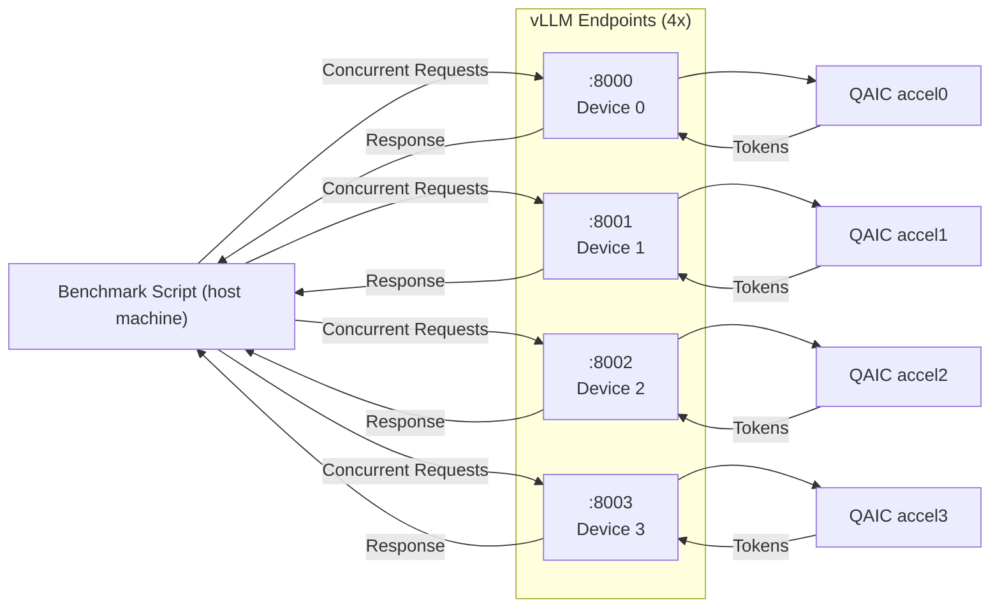
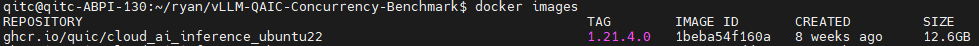
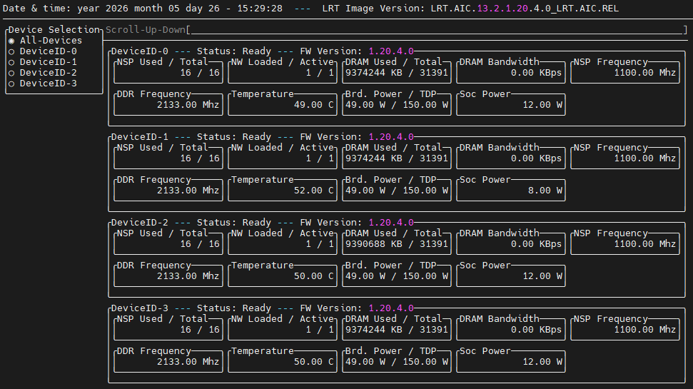
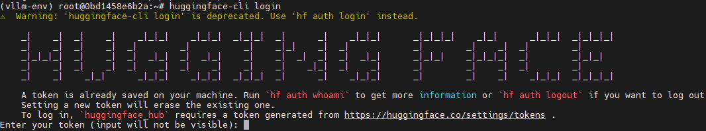
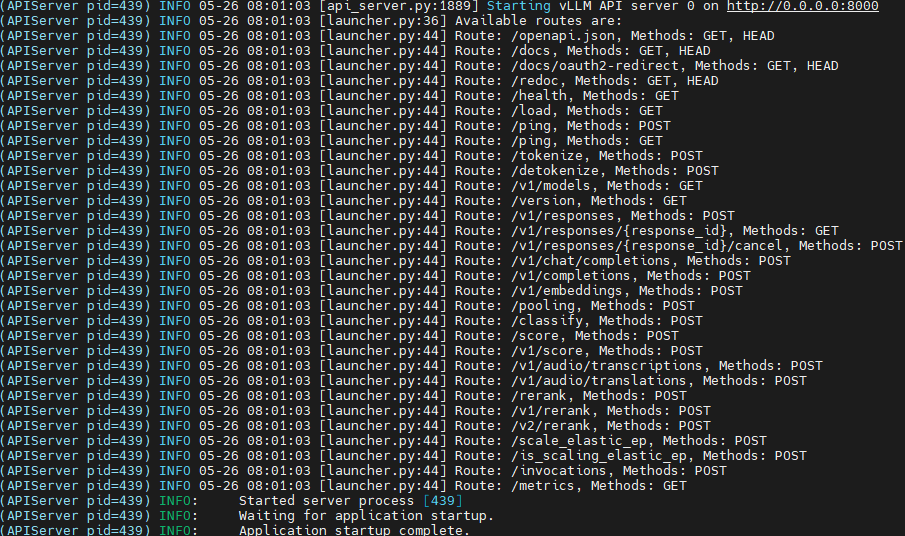
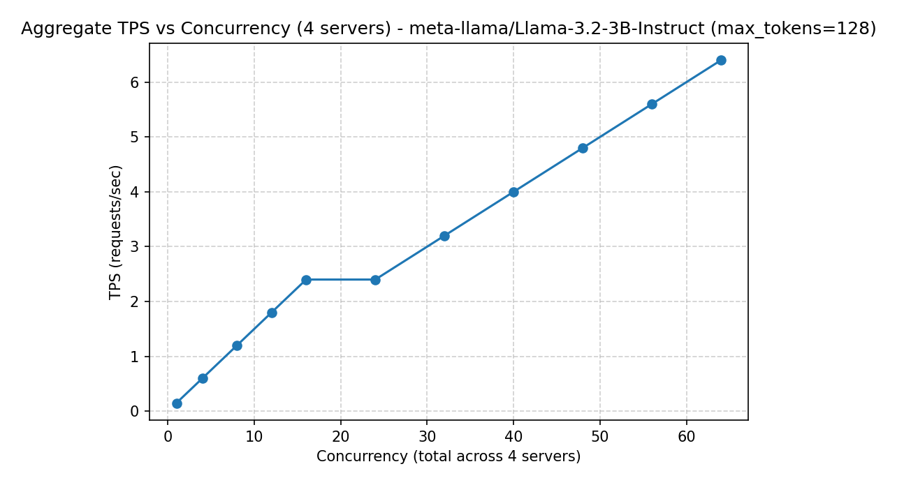
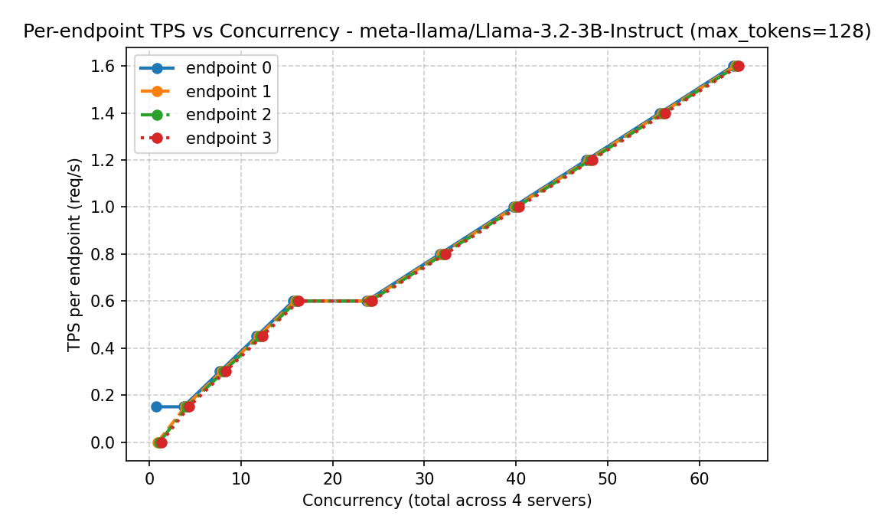

# [Startup_Demo](../../../)/[GenAI](../../)/[Cloud AI Playground](../)/[vLLM QAIC Concurrency Benchmark on AIC100](./)
# vLLM QAIC Concurrency Benchmark on AIC100

## 📘Table of Contents
- [🧭Overview](#1overview)
- [✨Features](#2features)
- [🐳Requirements](#3requirements)
- [⚙️Environment Setup](#4️environment-setup)
- [📊Benchmark Methodology](#5benchmark-methodology)
- [📦Benchmark Outputs](#6benchmark-outputs)
- [🚀Demo](#7demo)
- [✅Summary](#summary)
- [🔧Customization](#customization)
---
## 1.🧭Overview

This project benchmarks Large Language Model (LLM) serving performance on Qualcomm AIC100 using vLLM.

The benchmark evaluates:
- System-level throughput
- Concurrency scaling behavior
- Decode workload efficiency
- System limits under heavy load

The purpose is to provide a **comprehensive evaluation of QAIC hardware performance for LLM inference workloads**, including both optimal operating regions and failure conditions.


Each vLLM endpoint is pinned to a dedicated QAIC device, enabling independent inference pipelines and predictable scaling behavior.


---
## 2.✨Features

This benchmark provides the following analysis capabilities:

### 🔹 System Throughput Characterization

Measures total system throughput across multiple vLLM endpoints:
- Requests per second (TPS)
- Tokens per second (tokens/s)

Allows identification of:
- Peak performance
- Throughput saturation point

### 🔹 Concurrency Scaling Analysis
Evaluates system behavior as concurrency increases:
> concurrency = 1 → 64

Captures:
- Linear scaling region
- Saturation region
- Performance degradation

### 🔹 Decode Workload Sensitivity
Analyzes performance under different generation lengths:
> max_tokens = [32, 128, 512]

Reveals:
- Overhead-bound vs compute-bound regimes
- Efficiency trade-offs across workloads

### 🔹 Multi-Endpoint Load Distribution
Distributes load across 4 vLLM endpoints:
> worker_id % 4

Verifies:
- Balanced hardware utilization
- Absence of bottleneck devices

### 🔹 Failure and Stability Detection
Identifies system limits under stress and failure boundaries:
- Request failures
- Timeout conditions
- Throughput collapse

---
## 3.🐳Requirements

This section describes both the hardware platform (QAIC) and the software environment used for benchmarking.


### 3.1 AIC100 Hardware Platform (QAIC)

The Qualcomm AI Cloud Inference (QAIC) AIC100 is a dedicated AI inference accelerator designed for:

✅ Large-scale AI serving
✅ Energy-efficient inference
✅ On-prem deployment

#### 🔸 Architectural Characteristics

| Feature | Description |
|---------|-------------|
| Compute type | Dedicated inference accelerator |
| Execution model | Optimized for continuous inference |
| Parallelism | Multi-device scaling | 
| Memory model | KV cache intensive |
| Workload target | Sustained decode workloads |

#### 🔸 Hardware Specification

| Component | Description |
|----------|------------|
| Accelerator | Qualcomm Cloud AI 100 Ultra (AIC100 Ultra) |
| Device Interface | PCIe-based accelerator |
| Device Nodes | `/dev/accel/accel*` |
| Deployment Mode | Multi-device (4 cards in this benchmark) |
| Target Workload | LLM inference (Generative AI workloads) |

Reference: [Cloud AI 100 Ultra Overview](https://www.qualcomm.com/artificial-intelligence/data-center/cloud-ai-100-ultra#Overview)

### 3.2 Software Environment

- Ubuntu Linux host
- Python3
- Docker
- Qualcomm Cloud AI SDK (Platform & Apps) v1.21.4
- vLLM (OpenAI-compatible serving)

> ✅ Before you begin following this guide, you need to pre‑install the [Qualcomm Cloud AI SDK](https://quic.github.io/cloud-ai-sdk-pages/1.21/Getting-Started/Installation/sdk-installation.html) on the AIC100.

---
## 4.⚙️Environment Setup

### 4.1 Download the Docker Image

To enable multi-model server endpoints, you need to install the Docker image from the [Cloud AI Containers](https://github.com/quic/cloud-ai-containers/pkgs/container/cloud_ai_inference_ubuntu22).

Use the following command to download the image:
```bash
docker pull ghcr.io/quic/cloud_ai_inference_ubuntu22:1.21.4.0
```

Verify that the image was downloaded successfully:
```bash
docker images
```
If successful, the repository should appear in the list as shown below:


💡*This sample uses the Docker image version cloud_ai_inference_ubuntu22:1.21.4.0.*

### 4.2 Verify Available QAIC Devices

Before creating containers, verify the available QAIC devices using:
```bash
sudo /opt/qti-aic/tools/qaic-util -t 1
```

💡*To reproduce this multi-model server setup, four QAIC devices are required.*

### 4.3 Create Containers for Server Endpoints

In this sample, four LLM models are deployed, so four containers are required—one per server endpoint.

``` bash
docker run -dit --name vllm-aic100-s1-dg0 --device=/dev/accel/accel0 -v /home/qitc/:/home/qitc/ -p 8000:8000 ghcr.io/quic/cloud_ai_inference_ubuntu22:1.21.4.0

docker run -dit --name vllm-aic100-s2-dg1 --device=/dev/accel/accel1 -v /home/qitc/:/home/qitc/ -p 8001:8000 ghcr.io/quic/cloud_ai_inference_ubuntu22:1.21.4.0

docker run -dit --name vllm-aic100-s3-dg2 --device=/dev/accel/accel2 -v /home/qitc/:/home/qitc/ -p 8002:8000 ghcr.io/quic/cloud_ai_inference_ubuntu22:1.21.4.0

docker run -dit --name vllm-aic100-s4-dg3 --device=/dev/accel/accel3 -v /home/qitc/:/home/qitc/ -p 8003:8000 ghcr.io/quic/cloud_ai_inference_ubuntu22:1.21.4.0
```
Each container maps to one device and one port for serving an independent LLM endpoint.

This configuration ensures that each vLLM instance is pinned to a dedicated QAIC device, enabling isolated and predictable performance measurement.

### 4.4 Launching the Server

After creating the containers, all required dependencies are pre-installed.
Only the model download and server initialization are needed.

### 🔹 Hugging Face Setup

Enter each container:
```bash
docker exec -it vllm-aic100-s1-dg0 /bin/bash

docker exec -it vllm-aic100-s2-dg1 /bin/bash

docker exec -it vllm-aic100-s3-dg2 /bin/bash

docker exec -it vllm-aic100-s4-dg3 /bin/bash
```

Activate the pre-configured virtual environment (in each container):
```bash
source /opt/vllm-env/bin/activate
```

Login to Hugging Face (required for model access):
```bash
huggingface-cli login
```


💡*Note: If you don't have a token, sign in and request access from the model page: [meta-llama/Llama-3.2-3B-Instruct](https://huggingface.co/meta-llama/Llama-3.2-3B-Instruct).*

### 🔹 Start the vLLM Server

Run the following command in each container to launch the server:
```bash
python3 -m vllm.entrypoints.openai.api_server \
--host 0.0.0.0 \
--port 8000 \
--device-group 0 \
--model meta-llama/Llama-3.2-3B-Instruct \
--max-model-len 1024 \
--block-size 16 \
--quantization mxfp6 \
--kv-cache-dtype auto \
--disable-sliding-window \
--max-num-seqs 32
```
If the server starts successfully, you should see logs similar to:


---
## 5.📊Benchmark Methodology

### 🔹 Test Configuration

| Parameter | Value | 
|-----------|-------|
| Model | meta-llama/Llama-3.2-3B-Instruct |
| Prompt | "Explain what AI is in simple terms." | 
| max_tokens | 32 / 128 / 512 |
| Concurrency | 1 → 64 |
| Duration | 20 sec | 
| Warmup | 3 sec |
| Repeats | 3 |

### 🔹 Metrics

✅ Throughput
> TPS = number of successful requests completed per second
- Calculated over the measurement window (excluding warmup)
- Only successful responses are counted

✅ Tokens per Second (tokens/s)
> tokens/s = total completion tokens generated per second

In this benchmark:
- Most requests generate exactly `max_tokens`
- Therefore, tokens/s ≈ TPS × max_tokens

This results in near-linear scaling between TPS and tokens/s.

✅ Latency
- Average latency: mean end-to-end time per successful request  
- Maximum latency: worst-case request latency observed  

Includes:
- Network overhead  
- Scheduling delay  
- Model inference time  

✅ Per-endpoint Metrics
- TPS per endpoint (`ep0 ~ ep3`)  
- Tokens/sec per endpoint  

Used to evaluate:
- Load distribution across QAIC devices  
- System balance and hardware utilization  

✅ Failure Rate
- Counts failed requests per endpoint and globally  
- Includes:
  - Timeout failures  
  - Unsuccessful responses  

A high failure rate typically indicates:
- System saturation  
- Excessive queueing delay  
- Requests exceeding timeout limits under high concurrency


💡*Note: In this benchmark, tokens/sec scales approximately linearly with TPS under fixed max_tokens settings, indicating a stable and deterministic workload.*

---
## 6.📦Benchmark Outputs

This benchmark generates structured outputs for performance analysis and visualization.

These include raw metrics, throughput plots, latency plots, and multi-workload comparisons.


### 🔹 Result Files

| Category | Files | Purpose |
|---------|------|--------|
| Raw Metrics | `multi_results_tok*.csv` | Stores aggregated throughput, latency, and failure metrics |
| Throughput Plots | `multi_tps_tok*.png` | Visualizes TPS scaling behavior |
| Latency Plots | `multi_latency_tok*.png` | Visualizes latency trends across concurrency |
| Per-endpoint Metrics | `per_endpoint_tps_tok*.png` | Shows load distribution across endpoints |
| Comparative Analysis | `compare_*multi_tokens*.png` | Compares different workload behaviors |

All outputs are stored in: 
```
vLLM_QAIC_Concurrency_Benchmark_on_AIC100/results/
```

---
## 7.🚀Demo

This section demonstrates the performance of QAIC under a representative workload:

```code
max_tokens = 128 (balanced workload)
```

This setting provides the best trade-off between throughput, latency, and system stability.

### 🔹 Run the Benchmark


Execute the following command on the host machine (outside the container, e.g., AIC100 server).
```bash
python3 ./benchmark_multi_server_full_multitokens.py
```
💡*Note: This benchmark script runs outside the container and sends requests to the vLLM endpoints exposed by each container.*
## 🔹 Key Results (max_tokens=128)

| Concurrency | TPS (req/s) | Tokens/s | Avg Latency (s) |
|------------|------------|----------|----------------|
| 8  | 1.20 | 153.60 | 9.31 |
| 16 | 2.40 | 307.20 | 10.86 |
| 24 | 2.40 | 307.20 | 12.30 |
| 32 | 3.20 | 409.60 | 13.71 |
| 40 | 4.00 | 512.00 | 16.60 |
| 48 | 4.80 | 614.40 | 17.93 |
| 56 | 5.60 | 716.80 | 19.29 |
| 64 | 6.40 | 819.20✅ | 20.61 |


## 🔹 Throughput Scaling

The system demonstrates steady throughput scaling across all tested concurrency levels, with no significant degradation observed up to concurrency = 64.

Throughput continues to increase alongside concurrency, while latency grows gradually, indicating a shift toward a latency-bound regime at higher concurrency levels.



## 🔹 Per-Endpoint Load Distribution



Each endpoint shows nearly identical throughput across all tested concurrency levels, indicating:

- ✅ Balanced load distribution across QAIC devices
- ✅ No single-device bottleneck
- ✅ Stable multi-device scaling behavior

This confirms that the benchmarking setup effectively utilizes all available hardware resources.


---

## ✅Summary

This benchmark demonstrates the performance characteristics of QAIC under different concurrency levels and decode workloads.

Key findings include:

- ✅ Throughput increases steadily across the entire concurrency range (1 → 64)
- ✅ Peak performance of ~819 tokens/sec under `max_tokens = 128`
- ✅ No obvious throughput collapse observed within tested range
- ✅ Latency increases gradually with concurrency
- ✅ Stable and balanced utilization across all QAIC devices


💡 *Note: This benchmark is performed using: `meta-llama/Llama-3.2-3B-Instruct`.
Results may vary if different models (e.g., Qwen) are used due to architectural and decoding differences.*

---

## 🔧Customization

This benchmark can be easily adapted to evaluate different models or configurations.

To run tests with your own model, modify the following parameters in the script:

- `MODEL_NAME`
- `MAX_TOKENS_LIST`
- `CONCURRENCY_LEVELS`

For this example, the benchmark was performed using:
```python
meta-llama/Llama-3.2-3B-Instruct
```
Users can replace the model with any supported LLM (e.g., other Hugging Face models) to evaluate performance under different workloads.