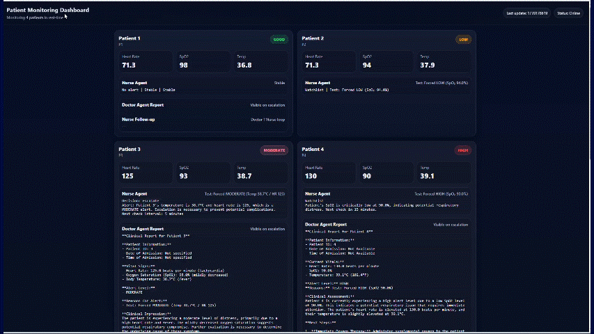

# [Startup_Demo](../../../)/[GenAI](../../)/[IoT-Robotics](../)/[Patient_Monitoring_Agent](./)

# Patient Monitoring Agent

## Table of Contents
- [1. Overview](#1-overview)
- [2. Requirements](#2-requirements)
  - [2.1 Hardware Requirements](#21-hardware-requirements)
  - [2.2 Software Requirements](#22-software-requirements)
- [3. System Workflow](#3-system-workflow)
- [4. Setup Instructions](#4-setup-instructions)
  - [4.1 Setting Up Visual Studio Code (VS Code)](#41-setting-up-visual-studio-code-vs-code)
  - [4.2 Setting Up Arduino App Lab](#42-setting-up-arduino-app-lab)
  - [4.3 Setting Up Arduino Flasher Cli](#43-setting-up-arduino-flasher-cli)
  - [4.4 Setting Up Arduino UNO-Q Device](#44-setting-up-arduino-uno-q-device)
- [5. Setting Up the Application](#5-setting-up-the-application)
- [6. Source Code Setup on Device](#6-source-code-setup-on-device)
- [7. Run the Patient Monitoring Agent Application](#7-run-the-patient-monitoring-agent-application)
- [8. Application Demo](#8-application-demo)

## 1. Overview.

The Patient Monitoring Agent is an AI-driven healthcare application designed to continuously track, analyze, and visualize patient vital signs. It leverages simulated sensor data, intelligent agents (CrewAI), and cloud-based AI models to provide proactive health monitoring and alerts.

The system aims to enhance patient care by enabling early detection of abnormalities, improving response time, and supporting healthcare professionals with data-driven insights.

- 📡 Real-Time Vital Sign Monitoring: Continuously collects and processes data from sensors such as heart rate, blood pressure, and oxygen saturation.
- 🧠 AI-Powered Anomaly Detection: Uses machine learning models to identify deviations from normal physiological parameters.
- 📊 Data Visualization: Provides real-time dashboards for healthcare providers to monitor patient status.
- 🚨 Alert System: Triggers notifications when critical thresholds are exceeded, ensuring timely intervention.
- 🔐 Secure Data Transmission: Ensures all patient data is encrypted and transmitted securely to cloud services.
- 🤖 Intelligent Agent Integration: Utilizes CrewAI to orchestrate multi-agent workflows for decision-making and alert routing.

## 2. Requirements.

### 2.1. Hardware Requirements. 

- **[Arduino® UNO Q](../../../Hardware/Arduino_UNO-Q.md#arduino-uno-q)**
- USB-C® hub adapter with external power (x1)
- A power supply (5 V, 3 A) for the USB hub (e.g., a phone charger)
- Snapdragon (Arm64) Windows PC for Compile the Binary.

### 2.2. Software Requirements.

- Arduino App Lab
- Bricks
- VS Code

## 3. System Workflow.

```mermaid
flowchart LR
    A[Start System] --> B[Initialize Arduino UNO-Q with App-Bricks]
    B --> C[Read Patient Vitals from Sensors or Simulator]
    C --> D[Preprocess and Validate Vitals Data]
    D --> E[Send Vitals to Patient Monitoring Agent Pipeline]
    E --> F[AI Analysis and CrewAI Reasoning]
    F --> G[Generate Recommendations]
    G --> H[Update Patient Monitor Dashboard]
    H --> J[✅ Patient Monitoring Agent Operation]
```



## 4. Setup Instructions.

Before proceeding further, please ensure that **all the setup steps outlined below are completed in the specified order**. These instructions are essential for configuring the various tools required to successfully run the application.

Each section provides a reference to internal documentation for detailed guidance. Please follow them carefully to avoid any setup issues later in the process.

## 4.1. Setting Up Visual Studio Code (VS Code).
Visual Studio Code is the recommended IDE for editing, debugging, and managing the project’s source code. It provides essential extensions and integrations that streamline development workflows. Please follow the setup instructions carefully to ensure compatibility with the project environment.

For detailed steps, refer to the internal documentation:
[Set up VS Code](../../../Tools/Software/VScode_Setup/README.md#34-configure-ssh)

## 4.2. Setting Up Arduino App Lab.
Arduino App Lab enables you to create and deploy Apps directly on the Arduino® UNO Q board, which integrates both a microcontroller and a Linux-based microprocessor. The App Lab runs seamlessly on personal computers (Windows, macOS, Linux) and comes pre-installed on the UNO Q, with automatic updates. Please follow the setup instructions carefully to ensure smooth development and deployment of Apps.

For detailed steps, refer to the documentation: 
[Set up Arduino App Lab]( ../../../Tools/Software/Arduino_App_Lab/README.md#4-installation)

## 4.3. Setting Up Arduino Flasher Cli.
Arduino Flasher CLI provides a streamlined way to flash Linux images onto your Arduino UNO Q board. Please follow the setup instructions carefully to avoid flashing errors and ensure proper board initialization.

For detailed steps, refer to the documentation: 
[Arduino Flasher CLI]( ../../../Hardware/Arduino_UNO-Q.md#flashing-a-new-image-to-the-uno-q)

## 4.4. Setting Up Arduino UNO-Q Device.
Arduino UNO-Q must be properly configured to ensure reliable communication with the host system and accurate sensor data acquisition. Please follow the setup instructions carefully to avoid hardware conflicts and ensure seamless integration with the software stack.

For detailed steps, refer to the documentation: 
[Set up Arduino UNO-Q]( ../../../Hardware/Arduino_UNO-Q.md#uno-q-as-a-single-board-computer).

## 5. Setting Up the Application.

### Prerequisites
The following requirements must be completed before setting up the application:

- The application uses a **cloud-hosted LLaMA model (LLaMA‑3.1‑8B)**.
- You must set up access to the [Cirrascale Cloud service](../../../Tools/Software/Cloud_PlayGround_Setup/README.md#2-set-up-the-cirrascale-cloud-service)
- Generate and obtain a valid **API token** for accessing the LLaMA model.

## 6. Source Code Setup on Device.

Clone the repository and transfer the source code to the device’s application directory. The following commands should be run in the terminal or command prompt. Ensure that the device is connected via ADB before proceeding.

   ```bash
   adb shell
   ```

   ```bash
   cd /home/arduino/ArduinoApps
   git clone -n --depth=1 --filter=tree:0 https://github.com/qualcomm/Startup-Demos.git
   cd Startup-Demos
   git sparse-checkout set --no-cone /GenAI/IoT-Robotics/Patient_Monitoring_Agent
   git checkout
   ```

## 7. Run the Patient Monitoring Agent Application.

Once your application is configured and built in Arduino App Lab, it can be deployed and executed directly on the Arduino UNO Q. This section will guide you through launching nd running the application.

 

### Update the API Token*

- Configure the API token in the **.env** file (Refer to Step 5 to copy the API key).

## 8. Application Demo.

The Patient Monitoring Agent application enables real-time monitoring of patient vital signs using sensor data or simulated inputs. The application continuously collects patient health parameters such as temperature, heart rate, and SpO₂, and processes them using AI-based analysis. It evaluates the patient’s condition and classifies it into different risk levels based on predefined logic and intelligent reasoning.

- CrewAI triggers only for MODERATE and HIGH severity patients.
- For GOOD (and LOW), CrewAI is not triggered — only vitals refresh and status is updated.
- Vitals and the dashboard refresh continuously (every loop/refresh cycle).


