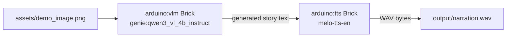
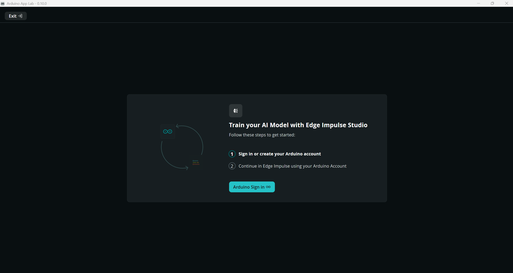
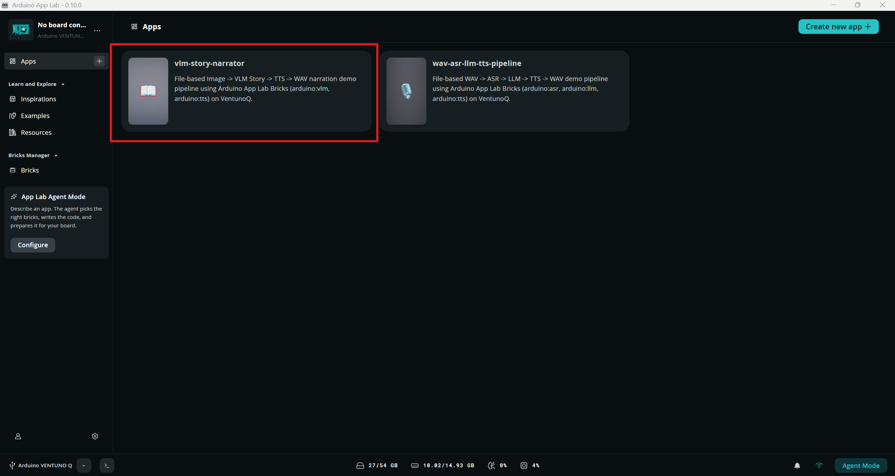
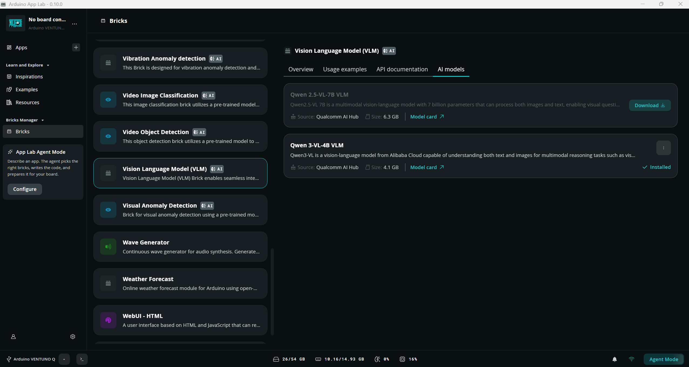
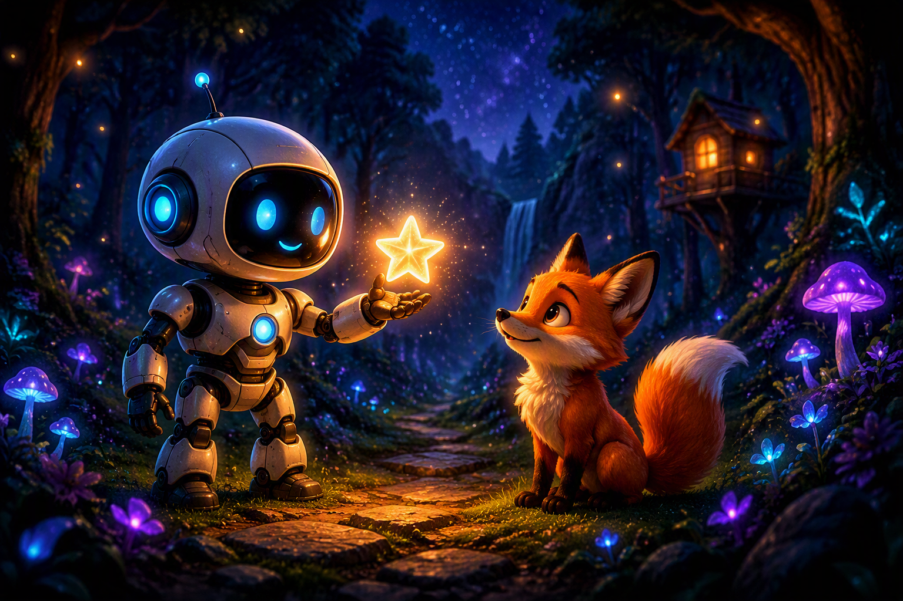

# Image → VLM Story → TTS Narrator (VentunoQ)

An on-device generative pipeline that chains two Arduino App Lab Bricks — a Vision Language Model and Text-to-Speech — into a single offline demo: an image goes in, an original short story about the image comes out, narrated as synthesized speech.

## Table of Contents

1. [Overview](#1-overview)
2. [Requirements](#2-requirements)
   - [2.1 Hardware Requirements](#21-hardware-requirements)
   - [2.2 Software Requirements](#22-software-requirements)
3. [Architecture](#3-architecture)
4. [Setup](#4-setup)
   - [4.1 Setting Up Visual Studio Code (VS Code)](#41-setting-up-visual-studio-code-vs-code)
   - [4.2 Setting Up Arduino App Lab](#42-setting-up-arduino-app-lab)
   - [4.3 Sample Deployment](#43-sample-deployment)
   - [4.4 Model Installation](#44-model-installation)
   - [4.5 Demo Image](#45-demo-image)
   - [4.6 Common Setup Pitfalls](#46-common-setup-pitfalls)
5. [Run](#5-run)
6. [Demo Result](#6-demo-result)
7. [Audio Demo](#7-audio-demo)

## 1. Overview

This sample demonstrates a fully on-device, offline image-to-speech storytelling pipeline on VentunoQ using Arduino App Lab Bricks: an image file is described and narrated into a short story by a local Vision Language Model (VLM), and the story is synthesized into a WAV file by a local Text-to-Speech (TTS) engine. No cloud calls and no physical camera or speaker are required — the input is a plain image file and the output is a plain WAV file.

## 2. Requirements

### 2.1 Hardware Requirements

- A VentunoQ device, network-reachable via SSH.
- No camera or speaker required — the pipeline is entirely file-based.

### 2.2 Software Requirements

- Arduino App Lab installed and registered on the device (`arduino-app-cli`, `arduino-app-lab`, `arduino-router`).
- The following two AI models, installed through the Arduino App Lab desktop application:

| Brick | Model |
|---|---|
| `arduino:vlm` | `genie:qwen3_vl_4b_instruct` |
| `arduino:tts` | `melo-tts-en` |

There is no command-line or API path for installing a model — install them through the App Lab GUI. If the AI Models list appears empty, restart Arduino App Lab; the models will then show as installed. `app.yaml` declares the models this app expects; App Lab reports a missing-model error at `app start` if any of them are not yet installed.

## 3. Architecture



## 4. Setup

### 4.1 Setting Up Visual Studio Code (VS Code)

Visual Studio Code is the recommended IDE for editing, debugging, and managing the project's source code. It provides essential extensions and integrations that streamline development workflows.

For detailed steps, refer to the documentation:
[Set up VS Code](../../../Tools/Software/VScode_Setup/README.md#34-configure-ssh)

### 4.2 Setting Up Arduino App Lab

Arduino App Lab enables you to create and deploy Apps directly on your VentunoQ board. The App Lab runs seamlessly on personal computers (Windows, macOS, Linux); this sample assumes it is already installed and running on the target VentunoQ device (see [2.2 Software Requirements](#22-software-requirements)).

Arduino App Lab also integrates with Edge Impulse to distribute the AI models used by each Brick: the AI Models page inside each Brick requires signing in with an Edge Impulse account before it can list and install available models (see [4.4 Model Installation](#44-model-installation) for the full model installation flow).



*Arduino App Lab 0.10.0 prompting for Arduino account sign-in before continuing to Edge Impulse Studio, shown when opening a Brick's AI Models page for the first time.*

For detailed steps, refer to the documentation:
[Set up Arduino App Lab](../../../Tools/Software/Arduino_App_Lab/README.md#4-installation)

Confirm Arduino App Lab is already installed and running on the VentunoQ device before continuing.

**Validated with Arduino App Lab 0.10.0.** Menu names, the AI Models page layout, and the Edge Impulse sign-in flow described in this README may differ on other App Lab versions.

### 4.3 Sample Deployment

1. Copy the sample onto the device (choose one):
   - From the published repository:
     ```bash
     git clone -n --depth=1 --filter=tree:0 https://github.com/qualcomm/Startup-Demos.git
     cd Startup-Demos
     git sparse-checkout set --no-cone /GenAI/IoT-Robotics/VLM_Story_Narrator
     git checkout
     ```
   - Or copy an existing local checkout directly:
     ```bash
     scp -r VLM_Story_Narrator arduino@<device-ip>:~/ArduinoApps/vlm-story-narrator
     ```
2. Register the app:
   ```bash
   arduino-app-cli app new "vlm-story-narrator" --from-app ~/ArduinoApps/vlm-story-narrator
   ```



*Arduino App Lab 0.10.0 home screen on the VentunoQ device, showing the registered `vlm-story-narrator` app.*

### 4.4 Model Installation

This sample uses two ready-made models from the Arduino App Lab Bricks catalog — no custom training or Edge Impulse project is required for this sample.

**App Lab and Edge Impulse integration**: Arduino App Lab distributes Brick models through Edge Impulse. Each Brick's AI Models page requires signing in with an Edge Impulse account before it can list and download available models; signing in only grants access to that Brick's model catalog and does not create or require a custom Edge Impulse project for this sample.

**Installing the required models (using the built-in Bricks models):**

1. Launch Arduino App Lab (see [4.2 Setting Up Arduino App Lab](#42-setting-up-arduino-app-lab)).
2. Open the Brick for each model listed in [Requirements](#2-requirements) (`arduino:vlm`, `arduino:tts`).
3. Sign in with your Edge Impulse account when prompted.
4. On the Brick's AI Models page, locate the required model (`genie:qwen3_vl_4b_instruct`, `melo-tts-en`).
5. Download/install the model through App Lab.
6. Confirm the model's status shows as installed before continuing.
7. Repeat for both Bricks, then proceed to [Run](#5-run).
8. If a model is missing and you run the app anyway, it fails immediately with a clear `Model "..." Is Not Installed` error — this means a model install step was missed, not a bug in this sample.



*`arduino:vlm` Brick's AI Models page in Arduino App Lab 0.10.0, showing `Qwen 3-VL-4B VLM` marked as Installed.*


*`arduino:tts` Brick's AI Models page in Arduino App Lab 0.10.0, showing `Melo TTS (English)` marked as Installed.*

### 4.5 Demo Image

1. This sample commits one AI-generated demo image at `assets/demo_image.png`, used both by the pipeline and by [6. Demo Result](#6-demo-result) below.
2. To use your own image, replace `assets/demo_image.png` or edit the `INPUT_IMAGE` constant in `python/main.py` to point at a different file.
3. This device has no physical camera attached, which is why the pipeline reads an image file instead of a live camera feed. The `arduino:vlm` Brick supports a live camera peripheral on devices that have one.



*`assets/demo_image.png` — the AI-generated demo image used as this sample's default VLM input.*

### 4.6 Common Setup Pitfalls

- Missing-model error at startup → see [4.4 Model Installation](#44-model-installation).
- AI Models list appears empty → restart Arduino App Lab.
- `assets/demo_image.png` missing → see [4.5 Demo Image](#45-demo-image).
- Cannot SSH to the device → confirm the device hostname/IP and network connectivity before proceeding.

## 5. Run

```bash
arduino-app-cli app start /home/arduino/ArduinoApps/vlm-story-narrator -v
```

**Success criteria:**
- stdout shows the stage progression: `PIPELINE_STAGE: VLM_START` → `VLM_DONE` → `TTS_START` → `TTS_DONE` → `PIPELINE_COMPLETE`
- Exit code `0`
- `output/story.txt` and `output/narration.wav` are created


*Arduino App Lab 0.10.0's built-in editor and launch console, confirming the `vlm-story-narrator` containers started successfully.*

## 6. Demo Result

| Stage | Source | Content |
|---|---|---|
| **Input Image** | `assets/demo_image.png` | A robot handing a glowing star to a fox in a bioluminescent forest |
| **Generated Story** | `output/story.txt` (`arduino:vlm`, `genie:qwen3_vl_4b_instruct`) | "In a glowing forest where stars danced above, a curious robot named Blinky held out a shimmering star, its light warm as a friend's. A fox with amber eyes and a fluffy tail sat beside, its paws tucked in quiet wonder. Together, they whispered secrets to the sky, where magic whispered through trees and mushrooms, under a velvet night filled with dreams and gentle glimmers of wonder." |
| **Narrated Audio** | `output/narration.wav` (`arduino:tts`, `melo-tts-en`) | Synthesized speech of the story above — see [7. Audio Demo](#7-audio-demo) for the downloadable file and metadata |

## 7. Audio Demo

This sample commits its generated narration WAV as a demo asset at [`assets/demo_narration.wav`](assets/demo_narration.wav), produced by the real on-device run of this pipeline documented in [6. Demo Result](#6-demo-result) above.

**Note:** GitHub does not render an inline audio player inside README files — use the link above to download and play the file locally.

### 7.1 Audio Metadata

| Property | Value |
|---|---|
| Format | PCM WAV |
| Channels | 1 (mono) |
| Sample width | 16-bit |
| Sample rate | 44,100 Hz |
| Frame count | 1,065,984 |
| Duration | ~24.17 s |
| File size | 2,132,012 bytes |

### 7.2 Corresponding Story Text

> In a glowing forest where stars danced above, a curious robot named Blinky held out a shimmering star, its light warm as a friend's. A fox with amber eyes and a fluffy tail sat beside, its paws tucked in quiet wonder. Together, they whispered secrets to the sky, where magic whispered through trees and mushrooms, under a velvet night filled with dreams and gentle glimmers of wonder.
