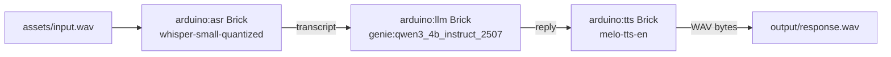
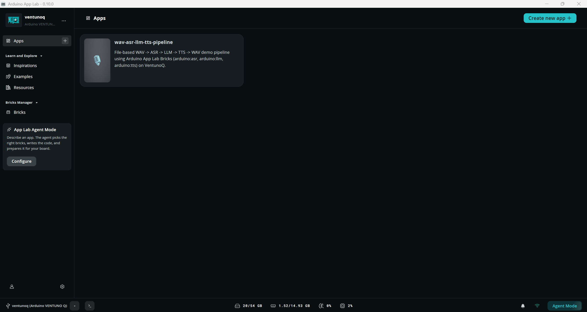
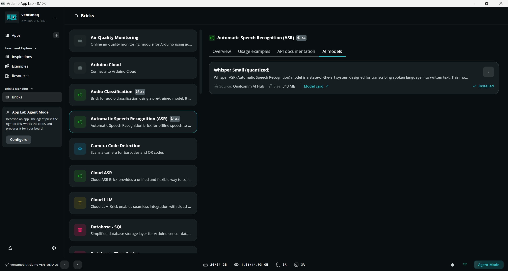
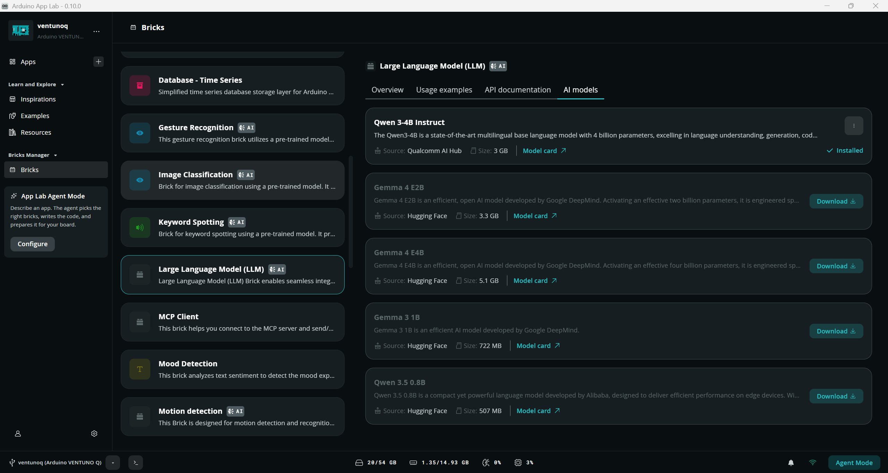
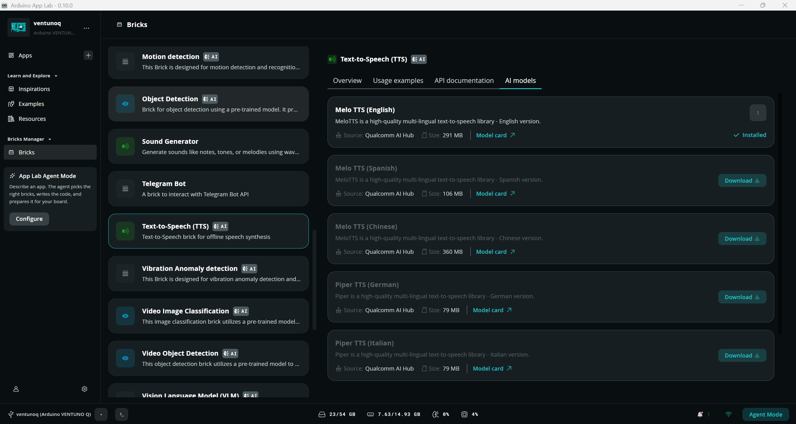

# WAV → ASR → LLM → TTS → WAV Voice Pipeline (VentunoQ)

A file-based, on-device voice pipeline that chains three Arduino App Lab Bricks — Automatic Speech Recognition, an LLM, and Text-to-Speech — into a single offline demo: a WAV file goes in, a WAV file comes out, with no microphone or speaker required.

## Table of Contents

1. [Overview](#1-overview)
2. [Requirements](#2-requirements)
   - [2.1 Hardware Requirements](#21-hardware-requirements)
   - [2.2 Software Requirements](#22-software-requirements)
3. [Architecture](#3-architecture)
4. [Setup](#4-setup)
   - [4.1 Setting Up Visual Studio Code (VS Code)](#41-setting-up-visual-studio-code-vs-code)
   - [4.2 Setting Up Arduino App Lab](#42-setting-up-arduino-app-lab)
   - [4.3 Sample Deployment](#43-sample-deployment)
   - [4.4 Model Installation](#44-model-installation)
   - [4.5 Input WAV Preparation](#45-input-wav-preparation)
   - [4.6 Common Setup Pitfalls](#46-common-setup-pitfalls)
5. [Run](#5-run)
6. [Demo Result](#6-demo-result)

## 1. Overview

This sample demonstrates a fully on-device, offline speech-in / speech-out pipeline on VentunoQ using Arduino App Lab Bricks: a spoken WAV file is transcribed, sent to an on-device LLM for a short reply, and the reply is synthesized back into a WAV file. No cloud calls and no physical microphone or speaker are required — input and output are plain WAV files.

## 2. Requirements

### 2.1 Hardware Requirements

- A VentunoQ device, network-reachable via SSH.
- No microphone or speaker required — the pipeline is entirely file-based.

### 2.2 Software Requirements

- Arduino App Lab installed and registered on the device (`arduino-app-cli`, `arduino-app-lab`, `arduino-router`).
- The following three AI models, installed through the Arduino App Lab desktop application:

| Brick | Model |
|---|---|
| `arduino:asr` | `whisper-small-quantized` |
| `arduino:llm` | `genie:qwen3_4b_instruct_2507` |
| `arduino:tts` | `melo-tts-en` |

There is no command-line or API path for installing a model — install them through the App Lab GUI. If the AI Models list appears empty, restart Arduino App Lab; the models will then show as installed. `app.yaml` declares the models this app expects; App Lab reports a missing-model error at `app start` if any of them are not yet installed.

## 3. Architecture



## 4. Setup

### 4.1 Setting Up Visual Studio Code (VS Code)

Visual Studio Code is the recommended IDE for editing, debugging, and managing the project's source code. It provides essential extensions and integrations that streamline development workflows.

For detailed steps, refer to the documentation:
[Set up VS Code](../../../Tools/Software/VScode_Setup/README.md#34-configure-ssh)

### 4.2 Setting Up Arduino App Lab

Arduino App Lab enables you to create and deploy Apps directly on your VentunoQ board. The App Lab runs seamlessly on personal computers (Windows, macOS, Linux); this sample assumes it is already installed and running on the target VentunoQ device (see [2.2 Software Requirements](#22-software-requirements)).

Arduino App Lab also integrates with Edge Impulse to distribute the AI models used by each Brick: the AI Models page inside each Brick requires signing in with an Edge Impulse account before it can list and install available models (see [4.4 Model Installation](#44-model-installation) for the full model installation flow).

For detailed steps, refer to the documentation:
[Set up Arduino App Lab](../../../Tools/Software/Arduino_App_Lab/README.md#4-installation)

Confirm Arduino App Lab is already installed and running on the VentunoQ device before continuing.

**Validated with Arduino App Lab 0.10.0.** Menu names, the AI Models page layout, and the Edge Impulse sign-in flow described in this README may differ on other App Lab versions.

### 4.3 Sample Deployment

1. Copy the sample onto the device (choose one):
   - From the published repository:
     ```bash
     git clone -n --depth=1 --filter=tree:0 https://github.com/qualcomm/Startup-Demos.git
     cd Startup-Demos
     git sparse-checkout set --no-cone /GenAI/IoT-Robotics/WAV_ASR_LLM_TTS_Pipeline
     git checkout
     ```
   - Or copy an existing local checkout directly:
     ```bash
     scp -r WAV_ASR_LLM_TTS_Pipeline arduino@<device-ip>:~/ArduinoApps/wav-asr-llm-tts-pipeline
     ```
2. Register the app:
   ```bash
   arduino-app-cli app new "wav-asr-llm-tts-pipeline" --from-app ~/ArduinoApps/wav-asr-llm-tts-pipeline
   ```



*Arduino App Lab 0.10.0 home screen on the VentunoQ device, showing the registered `wav-asr-llm-tts-pipeline` app.*

### 4.4 Model Installation

This sample uses three ready-made models from the Arduino App Lab Bricks catalog — no custom training or Edge Impulse project is required for this sample.

**App Lab and Edge Impulse integration**: Arduino App Lab distributes Brick models through Edge Impulse. Each Brick's AI Models page requires signing in with an Edge Impulse account before it can list and download available models; signing in only grants access to that Brick's model catalog and does not create or require a custom Edge Impulse project for this sample.

**Installing the required models (using the built-in Bricks models):**

1. Launch Arduino App Lab (version 0.10.0 — see [4.2 Setting Up Arduino App Lab](#42-setting-up-arduino-app-lab)).
2. Open the Brick for each model listed in [Requirements](#2-requirements) (`arduino:asr`, `arduino:llm`, `arduino:tts`).
3. Sign in with your Edge Impulse account when prompted.
4. On the Brick's AI Models page, locate the required model (`whisper-small-quantized`, `genie:qwen3_4b_instruct_2507`, `melo-tts-en`).
5. Download/install the model through App Lab.
6. Confirm the model's status shows as installed before continuing.
7. Repeat for all three Bricks, then proceed to [Run](#5-run).
8. If a model is missing and you run the app anyway, it fails immediately with a clear `Model "..." Is Not Installed` error — this means a model install step was missed, not a bug in this sample.



*`arduino:asr` Brick's AI Models page in Arduino App Lab 0.10.0, showing `Whisper Small (quantized)` marked as Installed.*



*`arduino:llm` Brick's AI Models page in Arduino App Lab 0.10.0, showing `Qwen 3-4B Instruct` marked as Installed.*



*`arduino:tts` Brick's AI Models page in Arduino App Lab 0.10.0, showing `Melo TTS (English)` marked as Installed.*

### 4.5 Input WAV Preparation

1. Supply your own WAV file at `assets/input.wav`: mono, 16-bit PCM, 16000 Hz. **No audio file is included with this sample** — no input or output WAV file is committed to this repository.
2. To read from a different path, edit the `INPUT_WAV` constant in `python/main.py`.
3. Converting an existing recording to the required format:
   ```bash
   ffmpeg -i your_recording.mp3 -ar 16000 -ac 1 -c:a pcm_s16le assets/input.wav
   ```
4. This device has no physical microphone or speaker attached, which is why the pipeline reads and writes files instead of live audio. The underlying Bricks (`arduino:asr`, `arduino:tts`) support live microphone/speaker peripherals on devices that have them.

### 4.6 Common Setup Pitfalls

- Missing-model error at startup → see [4.4 Model Installation](#44-model-installation).
- AI Models list appears empty → restart Arduino App Lab.
- `assets/input.wav` missing or in the wrong format → see [4.5 Input WAV Preparation](#45-input-wav-preparation).
- Cannot SSH to the device → confirm the device hostname/IP and network connectivity before proceeding.

## 5. Run

```bash
arduino-app-cli app start /home/arduino/ArduinoApps/wav-asr-llm-tts-pipeline -v
```

**Success criteria:**
- stdout shows the stage progression: `PIPELINE_STAGE: ASR_START` → `ASR_DONE` → `LLM_START` → `LLM_DONE` → `TTS_START` → `TTS_DONE` → `PIPELINE_COMPLETE`
- Exit code `0`
- `output/transcript.txt`, `output/llm_response.txt`, and `output/response.wav` are created


*Arduino App Lab 0.10.0's built-in editor and launch console, confirming the `wav-asr-llm-tts-pipeline` containers started successfully.*

## 6. Demo Result

| Stage | Source | Content |
|---|---|---|
| **Input Speech** | `assets/input.wav` | "Hello, this is a test of the Arduino Speech Recognition Brick." |
| **ASR Transcript** | `output/transcript.txt` (`arduino:asr`, `whisper-small-quantized`) | "Hello, this is a test of the Arduino Speech Recognition Brick." |
| **LLM Prompt** | sent to `arduino:llm` (`genie:qwen3_4b_instruct_2507`) | "Reply in one short sentence to this transcribed voice message: Hello, this is a test of the Arduino Speech Recognition Brick." |
| **LLM Response** | `output/llm_response.txt` | "Hello, this is a successful test of the Arduino Speech Recognition Brick." |
| **Output WAV** | `output/response.wav` (`arduino:tts`, `melo-tts-en`) | Synthesized speech of the LLM Response above — RIFF/WAVE, PCM 16-bit, mono, 44100 Hz |
