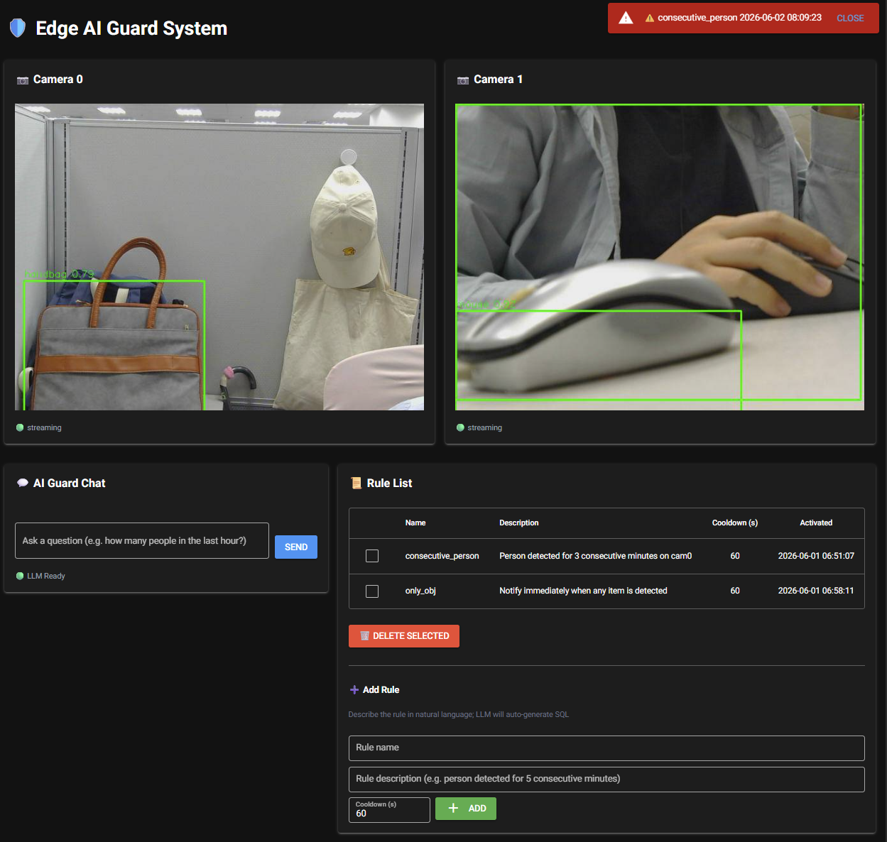
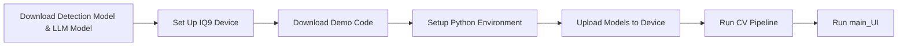
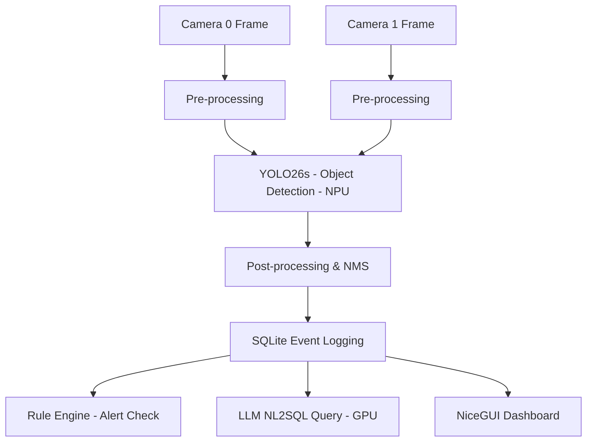
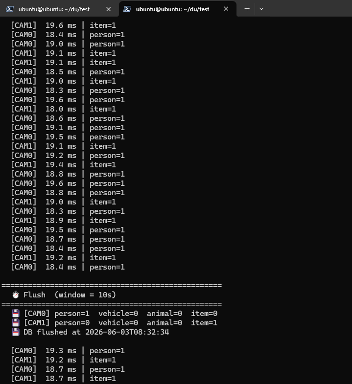
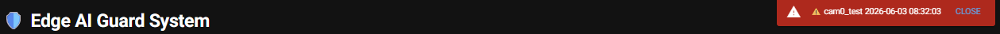
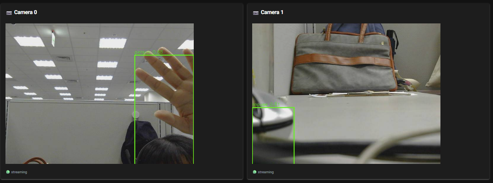
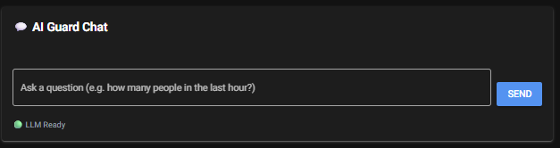
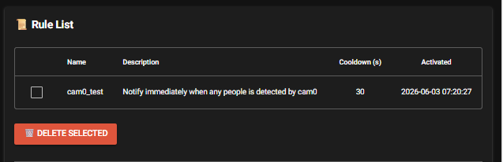
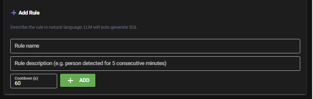
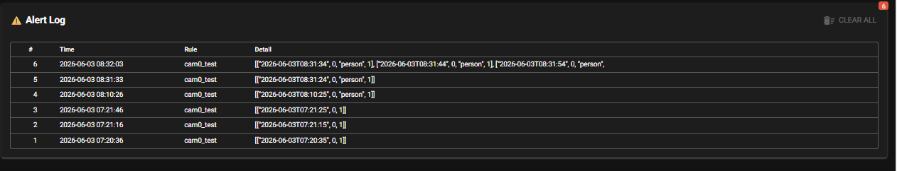

# [Startup_Demo](../../../)/[GenAI](../../)/[IoT-Robotics](../)/[ai_guard_system](./)

# Edge AI Guard System: On-Device Dual-Camera Surveillance with LLM-Powered Analytics

## Table of Contents
- [1. Overview](#1-overview)
- [2. Workflow Chart](#2-workflow-chart)
  - [2.1 Application Setup Flow](#21-application-setup-flow)
  - [2.2 Application Runtime Flow](#22-application-runtime-flow)
- [3. Prepare the Models](#3-prepare-the-models)
  - [3.1 Download the Object Detection Model and Label File](#31-download-the-object-detection-model-and-label-file)
  - [3.2 Download the LLM Model](#32-download-the-llm-model)
- [4. Setup Instructions](#4-setup-instructions)
  - [4.1 Setup IQ9 Device](#41-setup-iq9-device)
  - [4.2 Download Required Files from GitHub](#42-download-required-files-from-github)
  - [4.3 Setup Python Environment](#43-setup-python-environment)
- [5. Upload Models to the Device](#5-upload-models-to-the-device)
- [6. Run the Application](#6-run-the-application)
  - [6.1 Verify Required Files](#61-verify-required-files)
  - [6.2 Activate Python Environment and Run Application](#62-activate-python-environment-and-run-application)
  - [6.3 Demo Output](#63-demo-output)

## 1. Overview

This demo showcases an **Edge AI Guard System** — a fully on-device, dual-camera surveillance solution running on the **IQ9 (QCS9075)** platform. It combines **real-time object detection** with an **on-device Large Language Model (LLM)** for natural-language querying, rule-based alerting, and intelligent event analytics — all without cloud dependency.

The pipeline leverages two AI models simultaneously:
- **YOLO26s** — an object detection model running on the **NPU** (via TFLite QNN NPU delegate, ~18 ms per frame)
- **Gemma 4 E2B** — a large language model running on the **GPU** (via LiteRT delegate) for NL2SQL querying and event analytics

**Key features:**
- **Dual-camera CV pipeline** — Two USB cameras run concurrent object detection, logging every event (class, timestamp, camera ID) into a local **SQLite** database.
- **On-device LLM (NL2SQL)** — Users can ask natural-language questions (e.g., "How many people were detected in the last hour?") and the LLM translates them into SQL queries against the event database.
- **Rule engine & alerting** — A JSON-based rule configuration triggers real-time alerts (e.g., "Alert if > 5 persons detected within 1 minute").
- **NiceGUI web dashboard** — A browser-based UI provides live camera preview, LLM chat interface, rule management, alert notifications, and event history.

To better understand the underlying components, please refer to Qualcomm documentation on [Qualcomm GStreamer plugins](https://docs.qualcomm.com/doc/80-80021-50/topic/qim-sdk-plugins.html?product=895724676033554725&facet=Intelligent_Multimedia_SDK.SDK.2.0&version=2.0-rc2).



## 2. Workflow Chart

This section illustrates the workflow from application setup to runtime execution, followed by the internal processing flow of the Edge AI Guard System.

### 2.1 Application Setup Flow

This flow describes the steps required to prepare the environment and launch the demo application on the IQ9 platform.


### 2.2 Application Runtime Flow

This flow shows how the application processes frames from dual cameras. After detection and event logging, the **NiceGUI dashboard**, **LLM NL2SQL query**, and **rule engine alert check** all operate concurrently against the SQLite database.


## 3. Prepare the Models

Download the required models before running the application. This demo uses **YOLO26s** for object detection and **Gemma 4 E2B** as the on-device LLM.

Since model generation and download involve multiple steps, it is **recommended to perform these operations on a host PC** and then transfer the generated model files to the IQ9 device.

### 3.1 Download the Object Detection Model and Label File

The YOLO26 model is not directly available for download from the Qualcomm AI Hub web interface. Instead, please refer to the following guide, which provides step-by-step instructions for downloading an object detection model and its corresponding label file using the Qualcomm AI Hub Python API:

- [YOLO26 — ai-hub-models](https://github.com/qualcomm/ai-hub-models/blob/v0.52.0/src/qai_hub_models/models/yolo26_det/README.md)

Follow the instructions in the guide to download the **YOLO26** TFLite model and the **COCO label file**, then rename them as follows:
- Model file → `yolo26s.tflite`
- Label file → `coco_labels.txt`

> **Note:** The default model variant exported by ai-hub-models is YOLO26**n**. For this demo, please specify the **s** (small) variant during export to match the expected performance (~18 ms on NPU).
> ```bash
>python -m qai_hub_models.models.yolo26_det.export   --device "Dragonwing IQ-9075 EVK"   --target-runtime tflite   --ckpt-name yolo26s.pt
> ```

### 3.2 Download the LLM Model

This demo uses **Gemma 4 E2B** in **LiteRT** format (`.litert` file) as the on-device LLM. The pre-converted model is available on HuggingFace:

- [Gemma 4 E2B LiteRT model on HuggingFace](https://huggingface.co/litert-community/gemma-4-E2B-it-litert-lm)

Download the `.litert` model file. The expected file name is `gemma-4-E2B-it.litert`.

## 4. Setup Instructions

This section describes how to set up the runtime environment on the **IQ9 device**.
All commands below should be executed on the IQ9 device.

### 4.1 Setup IQ9 Device

Follow the official guide to set up the **IQ9 Development Kit** with **Ubuntu 24 Desktop**:
- [IQ9 Setup Guide](https://docs.qualcomm.com/doc/80-90441-252/topic/Integrate-and-flash-software.html?product=1601111740076074&facet=Ubuntu%20quickstart)

Ensure the device is properly powered, booted into the Ubuntu environment, and **connect to the device from your host PC via SSH or PuTTY**:
- [Connect IQ9 via PuTTY or SSH](https://docs.qualcomm.com/doc/80-90441-252/topic/Use-Ubuntu-on-iq9.html?product=1601111740076074&facet=Ubuntu%20quickstart)

> **Note:** The IQ9 device has limited USB ports. A **USB hub** is required to connect two USB cameras simultaneously. Ensure both cameras are recognized before running the application:
>
> ```bash
> v4l2-ctl --list-devices
> ```

### 4.2 Download Required Files from GitHub

Download only the files required for this demo using Git sparse checkout to minimize disk usage.
```
# On device
cd /home/ubuntu/
git clone -n --depth=1 --filter=tree:0 https://github.com/qualcomm/Startup-Demos.git
cd Startup-Demos
git sparse-checkout set --no-cone /GenAI/IoT-Robotics/ai_guard_system/
git checkout
```

### 4.3 Setup Python Environment

Navigate to the downloaded project directory and install the required system packages.
These are system packages and must be installed via `apt` before setting up the Python environment.

```
# On device
cd /home/ubuntu/Startup-Demos/GenAI/IoT-Robotics/ai_guard_system/
sudo apt update && sudo apt upgrade -y
sudo apt install -y \
  python3-gi gir1.2-gstreamer-1.0 gir1.2-gst-plugins-base-1.0 gstreamer1.0-tools \
  gstreamer1.0-plugins-base gstreamer1.0-plugins-good \
  python3.12-venv
```

All Python dependencies are managed in a single virtual environment
using `requirements.txt`. The `--system-site-packages` flag is used so that the system-installed `python3-gi` (GObject Introspection bindings) remains accessible
inside the virtual environment.
```
# On device
cd /home/ubuntu/Startup-Demos/GenAI/IoT-Robotics/ai_guard_system/
python3 -m venv --system-site-packages env
source env/bin/activate
pip install -r requirements.txt
```

References:
- [Virtual Environments](https://github.qualcomm.com/Innovationlab/qilab_platform_apps/tree/main/Tools/Software/Python_Setup#4-virtual-environments)

## 5. Upload Models to the Device

Transfer the downloaded model files and label file from your host PC to the IQ9 device.

Using **SCP**:
```bash
scp yolo26s.tflite user@<IQ9_IP>:~/Startup-Demos/GenAI/IoT-Robotics/ai_guard_system/src/
scp coco_labels.txt user@<IQ9_IP>:~/Startup-Demos/GenAI/IoT-Robotics/ai_guard_system/src/
scp gemma-4-E2B-it.litert user@<IQ9_IP>:~/Startup-Demos/GenAI/IoT-Robotics/ai_guard_system/src/
```

## 6. Run the Application

### 6.1 Verify Required Files

Before running the application, ensure the following files are present in the project directory:

```
ai_guard_system/src/
├── dashboard.py                 # NiceGUI web dashboard entry point
├── llm_engine.py      			 # LLM NL2SQL engine
├── cv_pipeline.py                # Dual-camera CV detection pipeline
├── frame_bridge.py			 # Shared memory for passing detection frames to dashboard
├── yolo26s.tflite             	 # Object detection model (NPU)
├── coco_labels.txt            	 # COCO class label file
└── gemma-4-E2B-it.litert    # LLM model (GPU, LiteRT format)
```

> **Note:** `rules.json`, `events.db`, and `alerts.db` are automatically generated at runtime and do not need to be prepared in advance.

### 6.2 Activate Python Environment and Run Application

Activate the virtual environment:
```bash
cd ~/Startup-Demos/GenAI/IoT-Robotics/ai_guard_system/
source ./env/bin/activate
```

Set the Wayland display environment variables:
```bash
export XDG_RUNTIME_DIR=/dev/socket/weston
export WAYLAND_DISPLAY=wayland-1
```

**Step 1 — Start the dual-camera CV pipeline:**

This launches the YOLO26s object detection on dual cameras and begins logging events to SQLite.
```bash
python cv_pipeline.py \\
    --model ./yolo26s.tflite \\
    --labels ./coco_labels.txt \\
    --delegate htp \\
    --source mjpeg \\
    --cam0-id 0 --cam1-id 1 \\
    --cam-width 640 --cam-height 480 \\
    --flush-interval 10 \\
    --score-thr 0.8 
```
> **Note:** To identify your USB camera device index (`--camera-id`) and supported formats, run:
>
> ```bash
> v4l2-ctl --list-devices
> v4l2-ctl -d /dev/video<N> --list-formats-ext
> ```

When the application runs successfully, terminal displays real-time performance metrics, detected objects:


**Step 2 — Launch the web dashboard (in a separate terminal):**

This starts the web UI which includes the LLM NL2SQL chat interface, live camera preview, rule management, and alert notifications.
```bash
python dashboard.py
```
Then open a browser and navigate to `http://<IQ9_IP>:8080` to access the dashboard.


### 6.3 Demo Output

#### Alert Banner

When a rule is triggered, a **red alert banner** appears at the top-right corner of the page, displaying the rule name and timestamp. Click **CLOSE** to dismiss the notification.

#### Live Camera Preview

The top row shows **side-by-side live video feeds** from Camera 0 and Camera 1. Each panel displays:
- Real-time frames with **green bounding boxes** and **class labels** overlaid on detected objects.
- A green **"streaming"** status indicator at the bottom-left, confirming the camera feed is active.

#### AI Guard Chat

Located on the left side of the second row. This is the **LLM-powered natural-language query interface**:
- Type a question in everyday language (e.g., *"How many people were detected in the last hour?"*) and click **SEND**.
- The on-device **Gemma 4 E2B** model automatically translates the question into a SQL query, executes it against the event database, and returns the result in the chat window.
- A green **"LLM Ready"** status indicator confirms the model is loaded and available.

#### Rule List

Located on the right side of the second row. This section displays all currently active alert rules in a table with the following columns:
- **Name** — Rule identifier.
- **Description** — Natural-language description of the trigger condition.
- **Cooldown (s)** — Minimum interval (in seconds) between repeated alerts for the same rule.
- **Activated** — Timestamp when the rule was created.

Each rule has a **checkbox** for selection. Click **DELETE SELECTED** to remove the selected rules.

#### Add Rule

Located below the Rule List. This form allows users to create new alert rules:
- **Rule name** — A unique identifier for the rule.
- **Rule description** — Describe the alert condition in natural language (e.g., *"person detected for 5 consecutive minutes"*). The LLM will auto-generate the corresponding SQL query.
- **Cooldown (s)** — The minimum interval between repeated alerts (default: 60 seconds).

Click **+ ADD** to register the new rule. It will immediately appear in the Rule List and begin monitoring.

#### Alert Log

The bottom section shows a **chronological log of all triggered alerts** in a table with the following columns:
- **#** — Alert sequence number.
- **Time** — Timestamp when the alert was triggered.
- **Rule** — Name of the rule that triggered the alert.
- **Detail** — Event details including detected class, camera ID, and timestamp.

A **red badge** in the top-right corner of this section displays the total alert count. Click **CLEAR ALL** to reset the alert log.

> **Note:** To stop the application, press `Ctrl+C` in each terminal.