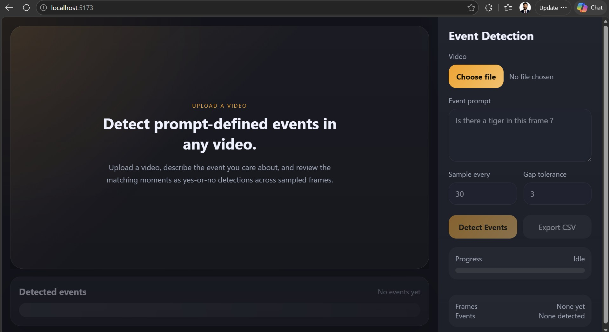
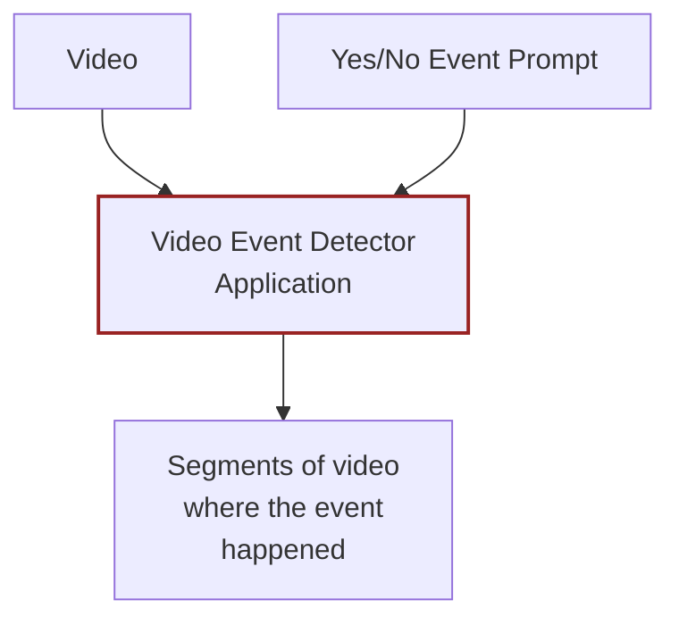

## [Startup_Demo](../../../)/[GenAI](../../)/[IoT-Robotics](../)/[video_event_detector](./)

# Video Event Detector

## Table of Contents
- [Video Event Detector](#video-event-detector)
  - [Table of Contents](#table-of-contents)
- [1. Overview](#1-overview)
- [2. Features](#2-features)
- [3. What is a Vision Language Model (VLM)?](#3-what-is-a-vision-language-model-vlm)
- [4. Requirements](#4-requirements)
  - [4.1 Hardware Requirements](#41-hardware-requirements)
- [5. Architecture](#5-architecture)
- [6. Model Setup](#6-model-setup)
  - [6.1 Build the InternVL3-1B Model](#61-build-the-internvl3-1b-model)
- [7. Project Setup](#7-project-setup)
  - [7.1 Clone the Repository](#71-clone-the-repository)
  - [7.2 Backend Setup](#72-backend-setup)
  - [7.3 Frontend Setup](#73-frontend-setup)
- [8. Run the Application](#8-run-the-application)
- [9. How to Use](#9-how-to-use)
  - [9.1 Upload a Video](#91-upload-a-video)
  - [9.2 Configure Detection Parameters](#92-configure-detection-parameters)
  - [9.3 Run Detection](#93-run-detection)
  - [9.4 Review Results](#94-review-results)
- [10. Use Cases](#10-use-cases)
  - [Resources](#resources)

# 1. Overview

**Video Event Detector** is an on-device video analysis application powered by the [InternVL3-1B](https://huggingface.co/OpenGVLab/InternVL3-1B) Vision Language Model (VLM). It allows users to define events using natural language prompts and automatically scans through a video to identify segments where those events occur.

Upload a video, describe the event you care about as a yes-or-no question, and the application reviews sampled frames to find all matching moments — entirely on-device with no cloud dependency.



# 2. Features

- **Prompt-driven event detection** — describe any event as a yes/no question and the VLM identifies matching frames.
- **On-device inference** — runs entirely on Qualcomm IoT platforms using the QNN runtime, no cloud required.
- **Configurable frame sampling** — control how many frames to skip between samples for speed vs. accuracy trade-off.
- **Gap tolerance grouping** — automatically merges nearby detections into continuous event segments.
- **Interactive timeline** — click on any detected event in the bottom bar to jump to and preview that video segment.
- **CSV export** — export all detection results with timestamps for further analysis.
- **Web-based UI** — clean React frontend served via Vite with a Flask backend.

# 3. What is a Vision Language Model (VLM)?

A **Vision Language Model (VLM)** is a type of multimodal AI model that can understand both images and text simultaneously. Unlike traditional computer vision models that are trained to detect a fixed set of objects, a VLM can answer open-ended questions about visual content using natural language.

This project uses **[InternVL3-1B](https://huggingface.co/OpenGVLab/InternVL3-1B)** by OpenGVLab — a compact yet capable VLM with 1 billion parameters. By leveraging a VLM, this application does not need to be retrained for each new event type. Instead, users simply change the text prompt to detect any event of interest, making it highly flexible for diverse surveillance and monitoring scenarios.

# 4. Requirements

## 4.1 Hardware Requirements

This application is compatible and tested with the following Qualcomm platforms:

| Platform | Product Links |
|----------|--------------|
| **QCS9075** | [Qualcomm IQ 9075 Evaluation Kit (EVK)](https://www.qualcomm.com/developer/hardware/qualcomm-iq-9075-evaluation-kit-evk) |
| **QCS8275** | [Qualcomm IQ 8275](https://www.qualcomm.com/internet-of-things/products/iq8-series/iq-8275), [Arduino Ventuno-Q](https://www.arduino.cc/product-ventuno-q) |

# 5. Architecture



The application works by sampling frames from the input video at a configurable interval. Each sampled frame is sent to the InternVL3-1B VLM along with the user-provided yes/no prompt. The model's response determines whether the event is present in that frame. Consecutive positive detections are then grouped (using the gap tolerance parameter) into continuous video segments for easy review.

# 6. Model Setup

> **Important:** This project does not include pre-built model files. You must build the InternVL3-1B model before running the application.

## 6.1 Build the InternVL3-1B Model

Use the ExecuTorch building tool provided in this repository to export and compile the model for on-device inference:

1. Follow the instructions in [Tools/executorch_building](../../../Tools/executorch_building/) to build the InternVL3-1B model.

2. Once the model is exported, copy the generated model artifacts to the deployment directory

Ensure all required model files are present in the `models/internvl/deploy/` directory before starting the application.

⚠️ **Disclaimer:** This project uses the [ExecuTorch](https://github.com/pytorch/executorch) framework to build and export the InternVL3-1B model for on-device inference. ExecuTorch handles model downloading and conversion from its sources during the build process. Users are responsible for reviewing and complying with the licensing terms, usage conditions, and distribution requirements of ExecuTorch and any models it downloads before using, modifying, or distributing this application.

# 7. Project Setup

## 7.1 Clone the Repository

```bash
git clone -n --depth=1 --filter=tree:0 https://github.com/qualcomm/Startup-Demos.git
cd Startup-Demos
git sparse-checkout set --no-cone /GenAI/IoT-Robotics/video_event_detector
git checkout
cd GenAI/IoT-Robotics/video_event_detector
```

## 7.2 Backend Setup

Set up a Python virtual environment and install the required dependencies:

```bash
python3 -m venv venv
source venv/bin/activate
pip install -r backend/requirements.txt
```

## 7.3 Frontend Setup

Install the Node.js dependencies for the React frontend:

```bash
npm --prefix frontend install
```

# 8. Run the Application

Use the provided `run.sh` script to start both the backend and frontend in detached `screen` sessions:

```bash
./run.sh
```

This will start:
- **Backend** (Flask API) on port `5000`
- **Frontend** (Vite dev server) on port `5173`

To view logs:
```bash
screen -r video-analysis-backend   # Backend logs
screen -r video-analysis-frontend  # Frontend logs
```

Once running, open a browser and navigate to `http://<device-ip>:5173` to access the application.

# 9. How to Use

## 9.1 Upload a Video

Click the **Choose file** button in the **Event Detection** panel on the right side of the screen to upload a video file. The video will appear in the main preview area on the left.

## 9.2 Configure Detection Parameters

| Parameter | Description | Example |
|-----------|-------------|---------|
| **Event prompt** | A yes-or-no question describing the event to detect. The VLM answers this question for each sampled frame. | `Is there a tiger in this frame?` |
| **Sample every** | Number of frames to skip between each sampled frame. Higher values speed up analysis but may miss short events. | `30` (analyzes every 30th frame) |
| **Gap tolerance** | Maximum number of consecutive non-detection frames allowed within a single event segment. If detections at frame 20 and frame 23 have a gap tolerance of 3, they are merged into one segment. If the gap exceeds this value (e.g., frame 20 and frame 24 with tolerance 3), they become two separate detections. | `3` |

## 9.3 Run Detection

Click the **Detect Events** button to start the analysis. The progress bar will show real-time status as frames are processed. The VLM evaluates each sampled frame against your event prompt and streams results back to the UI.

## 9.4 Review Results

- **Detected events timeline** — A bar at the bottom of the screen displays all detected event segments. Click on any segment to jump to that portion of the video and preview it.
- **Export CSV** — Click the **Export CSV** button to download a CSV file containing all detection results with frame numbers and timestamps for further analysis or reporting.

# 10. Use Cases

- **Automated camera surveillance** — detect specific events (intrusions, unusual activity) in security footage without manual review.
- **Wildlife monitoring** — identify animal appearances in long-duration camera trap videos.
- **Industrial inspection** — flag frames where defects or anomalies appear on a production line.
- **Robotics** — enable robots with cameras to detect and respond to specific visual events in their environment.
- **Traffic monitoring** — detect incidents, violations, or specific vehicle types in traffic camera feeds.
- **Content moderation** — scan video content for specific visual events that require review.

## Resources

- [InternVL3-1B on HuggingFace](https://huggingface.co/OpenGVLab/InternVL3-1B)
- [ExecuTorch Building Tool](../../../Tools/executorch_building/)
- [Qualcomm IQ 9075 EVK](https://www.qualcomm.com/developer/hardware/qualcomm-iq-9075-evaluation-kit-evk)
- [Qualcomm IQ 8275](https://www.qualcomm.com/internet-of-things/products/iq8-series/iq-8275)
- [Arduino Ventuno-Q](https://www.arduino.cc/product-ventuno-q)
