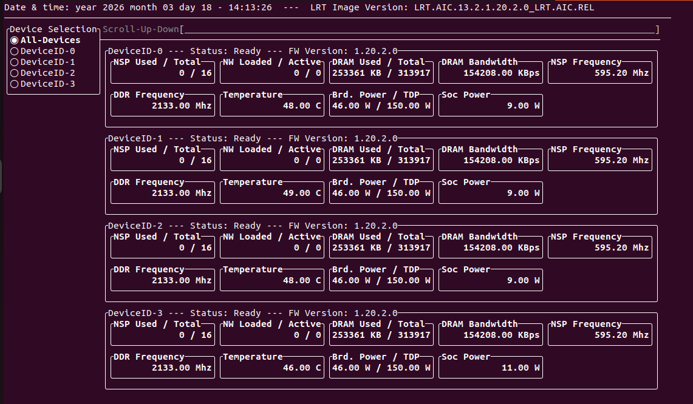
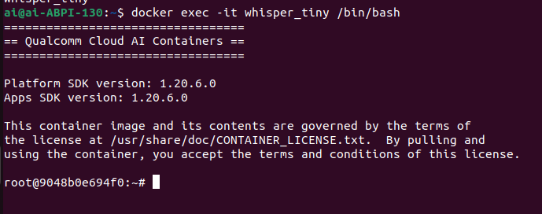
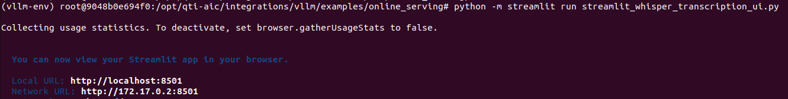
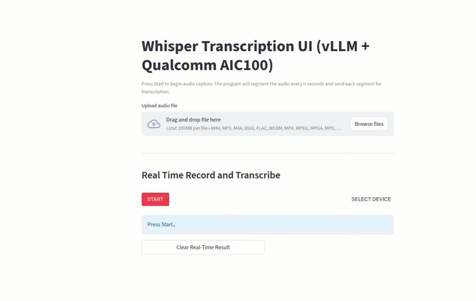

# [Startup_Demo](../../../)/[Others](../../)/[CloudAI-Playground](../)/[Whisper Serving on AIC100 with vLLM](./)
# Whisper Serving on AIC100 with vLLM

A speech-to-text application that supports both offline audio file transcription and real-time microphone transcription using Whisper-tiny.en model served through a vLLM server with WebUI.

## Table of Contents

- [1. Overview](#1-overview)
- [2. Features](#2-features)
- [3. Requirements](#3-requirements)
	- [3.1 Platform](#31-platform)
	- [3.2 Tools and SDKs](#32-tools-and-sdks)
- [4. Environment Setup](#4-environment-setup)
	- [4.1 Download Docker Image](#41-download-docker-image)
	- [4.2 Verify Available QAIC Devices](#42-verify-available-qaic-devices)
	- [4.3 Create the Container for Model Deployment](#43-create-the-container-for-model-deployment)
- [5. Launching the Server](#5-launching-the-server)
- [6. Web Client Setup](#6-web-client-setup)
- [7. Demo](#7-demo)

## 1. Overview

This project demonstrates how to deploy a Whisper-based speech recognition service on Qualcomm AIC100 using a vLLM OpenAI-compatible API server, together with a Streamlit-based WebUI.

The application supports two main usage modes. First, it provides offline transcription for uploaded audio files. Second, it supports real-time microphone transcription from the browser by continuously capturing audio, segmenting it into short chunks, sending the segments to the backend inference service, and displaying the recognized text through the same Whisper API.

The backend inference service runs on Qualcomm AIC100 and serves the `openai/whisper-tiny.en` model through vLLM. The frontend is implemented with Streamlit and provides an interactive interface for file upload, live transcription, result display, and transcription history management.

## 2. Features


- **Whisper Inference on Qualcomm AIC100:** Deploy the Whisper speech recognition model through a vLLM OpenAI-compatible API server running on QAIC hardware.
- **Offline Audio File Transcription:** Upload audio files and generate text transcriptions through the WebUI.
- **Real-Time Microphone Transcription:** Capture live browser audio through WebRTC and transcribe it in near real time.
- **Unified Streamlit WebUI:** Interact with both offline and live transcription modes from a single interface.
- **Adjustable Inference Settings:** Configure API endpoint, API key, language, temperature, response format, and streaming behavior from the sidebar.
- **Live Recording Controls:** Tune real-time segment length, overlap, rolling decode window, and decode interval for live transcription workflows.
- **Transcription History:** Review previous transcription results directly in the UI.


## 3. Requirements

### 3.1 Platform

- Qualcomm AIC100

### 3.2 Tools and SDKs

- Qualcomm Cloud AI SDK
- Cloud AI Containers
- Python Required packages
	- vllm
	- vllm[audio]
	- streamlit
	- streamlit-webrtc
	- openai
	- av
	- numpy
	- pydub
- [FFmpeg](https://github.com/BtbN/FFmpeg-Builds/releases/download/latest/ffmpeg-master-latest-win64-gpl.zip)
	- FFmpeg is required for handling multimedia files and streams.


## 4. Environment Setup

> Before you begin following this guide, you need to pre‑install the [Qualcomm Cloud AI SDK](https://quic.github.io/cloud-ai-sdk-pages/1.20/Getting-Started/Installation/Cloud-AI-SDK/Cloud-AI-SDK/index.html) on the AIC100.

### 4.1 Download Docker Image

To enable Whisper model deployment on Qualcomm AIC100, download a Cloud AI container image with vLLM support from the [Cloud AI Containers](https://github.com/quic/cloud-ai-containers/pkgs/container/cloud_ai_inference_ubuntu22) repository.

Use the following command to pull the image:

```bash
docker pull ghcr.io/quic/cloud_ai_inference_ubuntu22:1.20.6.0
```

You can check it with the following command:
```bash
docker images
```

*This sample application uses Docker image version cloud_ai_inference_ubuntu22:1.20.6.0*

### 4.2 Verify Available QAIC Devices

Before creating the container, check the available QAIC devices by using the following command:
```bash
sudo /opt/qti-aic/tools/qaic-util -t 1
```
You'll see the following:


According to the current setup in this sample, Whisper is deployed through a single-QPC approach, so only one QAIC device is required.

### 4.3 Create the Container for Model Deployment

Use the following command to create the container:
```bash
docker run -dit --name whisper_tiny --device=/dev/accel/accel0 -v /home/qitc/:/home/qitc/ -p 8000:8000 -p 8501:8501 ghcr.io/quic/cloud_ai_inference_ubuntu22:1.20.6.0
``` 
> *Two ports are configured for different purposes: one for the OpenAI-compatible API server and one for the WebUI. In this sample, exposing both ports is recommended because browser microphone access for real-time transcription is expected to work through localhost access.*

## 5. Launching the Server

In this section, we will enter the container and launch the Whisper inference server.

Use the following command to check the existing containers and their status:
```bash
docker ps -a
```

Enter the container with the following command:
```bash
docker exec -it whisper_tiny /bin/bash
```

If it succeeds, you'll see the following:


Activate the Python virtual environment included in the image:
```bash
source /opt/vllm-env/bin/activate
```

Install required Python packages:
```bash
pip install vllm vllm[audio] streamlit openai av streamlit-webrtc numpy pydub
```

Launch the vLLM OpenAI-compatible API server with the following command:
```bash
python -m vllm.entrypoints.openai.api_server \
--host 0.0.0.0 \
--port 8000 \
--device qaic \
--device-group 0 \
--model openai/whisper-tiny.en \
--max-model-len 150 \
--max-seq-len-to-capture 1 \
--quantization mxfp6 \
--limit-mm-per-prompt audio=1 \
--max-num-seqs 1 \
--trust_remote_code
```

Once the server starts successfully, it will expose an OpenAI-compatible transcription endpoint that can be accessed by the Streamlit WebUI.


## 6. Web Client Setup

The project includes a Streamlit-based Web Client that allows you to interact with the deployed Whisper model server through a single unified interface. The client supports both offline audio file transcription and real-time microphone transcription through the same backend service.

This client runs directly on the AIC100 host and communicates with the vLLM server through an HTTP API endpoint. By default, the application connects to `http://localhost:8000/v1` and uses `openai/whisper-tiny.en` as the default model.


On the AIC100 host, run the following commands:

1. Follow the commands below to set up the source code:
```bash
cd ~
git clone -n --depth=1 --filter=tree:0 https://github.com/qualcomm/Startup-Demos.git
cd Startup-Demos
git sparse-checkout set --no-cone /GenAI/CloudAI-Playground/whisper-serving-on-aic100-with-vllm/
git checkout
```

2. Install the Python packages using client_requirements.txt, which contains the dependencies required for the client
```bash
cd GenAI/CloudAI-Playground/whisper-serving-on-aic100-with-vllm/
python -m pip install -r client_requirements.txt
```

3. Launch the Web Client with the following command:
```bash
python -m streamlit run streamlit_whisper_transcription_ui.py
```

If the client application is working properly, the log output will look similar to the example below:


4. Once started, the Web Client will be available at:
```bash
http://localhost:8501 or http://<URL>:8501
```

After startup, open the Streamlit page in your browser and configure the API Base URL, API Key, and model if needed. You can then either upload an audio file for offline transcription or start live microphone capture for real-time transcription.

## 7. Demo

Once you complete the setup, you can begin using the application through the WebUI.
The demo supports:

- uploading an audio file and receiving a transcription result
- capturing microphone input in real time
- displaying the latest transcription result
- reviewing previous transcription history



## References

[Streamlit - vLLM](https://docs.vllm.ai/en/stable/deployment/frameworks/streamlit/?h=streamlit)

[Streamlit OpenAI Chatbot Webserver - vLLM](https://docs.vllm.ai/en/stable/examples/applications/chatbot/?h=streamlit_openai_chatbot_webserver#streamlit-openai-chatbot-webserver)

[OpenAI Transcription Client - vLLM](https://docs.vllm.ai/en/stable/examples/speech_to_text/openai/?h=openai+transcription+client#openai-transcription-client)