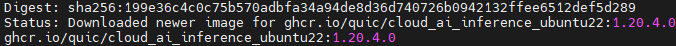
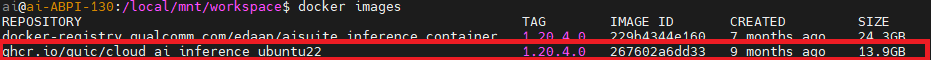
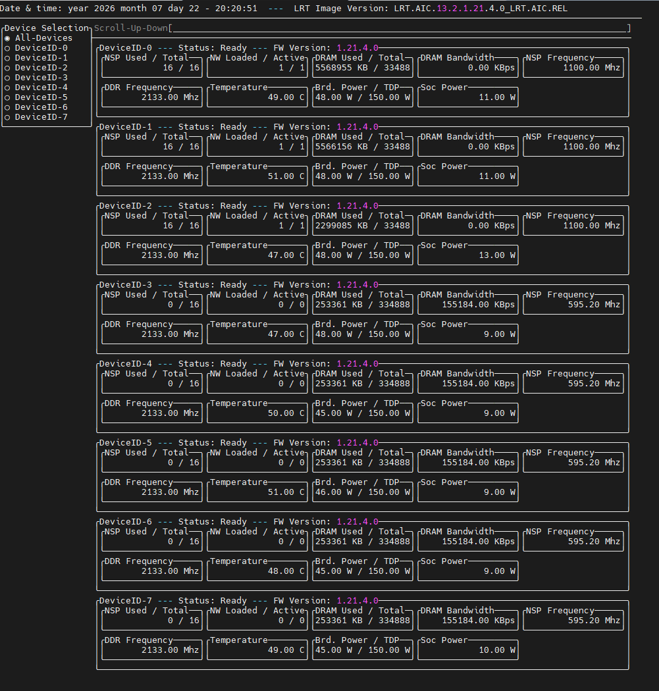

# Cloud AI ADK Setup Guide

# Table of Contents

- [Cloud AI SDK Overview](#1-cloud-ai-sdk-overview)
- [Cloud AI SDK Components](#2-cloud-ai-sdk-components)
- [Setup Steps](#3-setup-steps)
- [Download the Docker Image](#4-download-the-docker-image)


# 1. Cloud AI SDK Overview
Cloud AI SDKs optimize AI models for high-performance inference, providing model optimization, runtime execution, and deployment support through ONNX Runtime and Triton Inference Server.

- Optimizes AI models for high-performance inference on Cloud AI accelerators.
- Supports Generative AI, NLP, and Computer Vision workloads.
- Enables model optimization through quantization for better throughput, latency, and accuracy.
- Supports deployment with ONNX Runtime, Triton Inference Server, vLLM, and Text Generation Inference.
- Provides tools for application development, execution, monitoring, and debugging.

# 2. Cloud AI SDK Components

- Apps SDK: Model conversion, optimization, compilation, and runtime binary generation.
- Platform SDK: Drivers, runtime APIs, firmware, monitoring, telemetry, and debugging tools

# 3. Setup Steps

## 3.1 SDK Installation and Setup

The Cloud AI SDK consists of two main components that need to be installed and configured:

### Platform SDK
The Platform SDK includes drivers, runtime APIs, firmware, monitoring, telemetry, and debugging tools necessary for the Cloud AI accelerators.

**Installation Guide:** [Platform SDK Setup Instructions](https://quic.github.io/cloud-ai-sdk-pages/1.20/Getting-Started/Installation/Cloud-AI-SDK/Cloud-AI-SDK/index.html#platform-sdk)

### Apps SDK
The Apps SDK provides tools for model conversion, optimization, compilation, and runtime binary generation for your AI models.

**Installation Guide:** [Apps SDK Setup Instructions](https://quic.github.io/cloud-ai-sdk-pages/1.20/Getting-Started/Installation/Cloud-AI-SDK/Cloud-AI-SDK/index.html#apps-sdk)

**Complete Setup Guide:** [Cloud AI SDK Installation](https://quic.github.io/cloud-ai-sdk-pages/1.20/Getting-Started/Installation/Cloud-AI-SDK/Cloud-AI-SDK/index.html)

For detailed information about the AIC100 accelerator and its capabilities, refer to the [AIC100 Product Documentation](https://www.qualcomm.com/data-center/products/cloud-ai-100-ultra).

# 4. Download the Docker Image

To enable Docker, you need to install the Docker image from the [Cloud AI Containers](https://github.com/quic/cloud-ai-containers/pkgs/container/cloud_ai_inference_ubuntu22).

Follow the command below to install the image:
```bash
docker pull ghcr.io/quic/cloud_ai_inference_ubuntu22:1.20.4.0
```


Use the following command to verify that the image was downloaded successfully:
```bash
docker images
```

If successful, you will see the repository listed as shown in the image:



💡*This sample uses the Docker image version cloud_ai_inference_ubuntu22:1.20.4.0.*

##  Verify Available QAIC Devices
Before creating a container with the downloaded image, you need to check which QAIC devices are available by using the command below:
```bash
sudo /opt/qti-aic/tools/qaic-util -t 1
```

