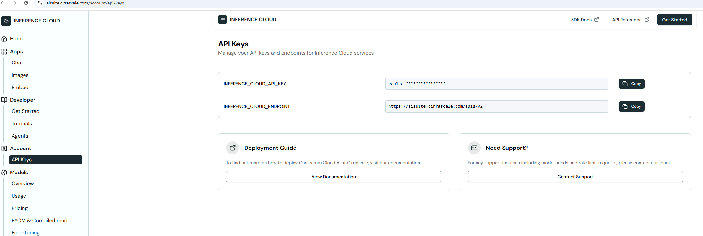

# CloudPlayGround Setup

# Table of Contents
- [Overview](#1-overview)
- [Set up the Cloud Service](#2-set-up-the-cloud-service)

# 1. Overview
Cloud Playground is a cloud-based platform that enables rapid development and deployment of AI applications, offering scalable infrastructure, pre-configured environments, and seamless integration with Snapdragon-based edge devices.

# 2. Set up the Cirrascale Cloud Service.
To enable secure communication with the Cirrascale cloud service, you need to configure your API token. This token authenticates your device and grants access to the cloud resources required for data transmission and AI model inference.

### Setup Steps

1. **Set up the Cloud Service**
   - Register/login to the Cirrascale AI Suite platform.
   - Generate an **API token** for the LLaMA‑3.1‑8B model.

2. **Obtain the API Token:**
   - Log in to your [Cirrascale](https://aisuite.cirrascale.com/) account.
   - Navigate to the **API Access** section.
   - Generate a new API token or retrieve an existing one.

